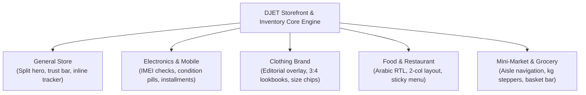

# DJET Store

> **Permanence by Design** — High-performance, self-hostable e-commerce and supply-chain engine built by [DJET Systems](https://djet.online).

[](https://github.com/DJET-Systems/djet-store/actions)
[](https://www.python.org/)
[](https://www.djangoproject.com/)
[](https://www.postgresql.org/)
[](docs/DEVELOPER-GUIDE.md)
[](docs/blueprints/014-security-baseline.md)

---

## 🌟 Executive Overview

**DJET Store** is an enterprise-grade e-commerce and physical supply-chain platform developed specifically for merchants in Egypt and the MENA region. While traditional SaaS platforms charge extractive revenue percentages and impose rigid generic storefront templates, DJET Store provides **total permanence, sub-50ms performance, and an immutable inventory ledger** you own and control.

Guided by **ADR-0004** (*"One Engine, Five Vertical Presets, Infinite Extensibility"*), DJET Store delivers specialized retail workflows through a single polymorphic codebase:



---

## 🚀 15-Minute Turnkey Client Provisioning

When launching a new client store, DJET Systems engineers can deploy a production-ready environment in minutes using the swanky interactive provisioning CLI:

```text
 ╔═════════════════════════════════════════════════════════════════════════════╗
 ║  DJET SYSTEMS · OFFICIAL ARCHITECTURE SPECIFICATION & STAMP                 ║
 ║  Signature : 0xDJET-99A4-PERMANENCE-BY-DESIGN                               ║
 ║  Architect : Anas Ghareib (Founder & Lead Security Architect)               ║
 ║  Standard  : ADR-0004 · Zero-Trust RBAC · Append-Only Stock Ledger          ║
 ╚═════════════════════════════════════════════════════════════════════════════╝
```

### Quickstart Workflow

```bash
# 1. Clone the repository for your client engagement
git clone git@github.com:djetsystems/djet-store.git client-store-acme
cd client-store-acme

# 2. Run the interactive turnkey store provisioner
bin/setup-store

# 3. Start the development server
bin/dev
```

### Modes of Execution

#### Mode A: Interactive Questionnaire (Default)
`bin/setup-store` guides the developer through an interactive interview with smart defaults on `[ENTER]`:
1. **Vertical Preset:** Choose `[1] general`, `[2] electronics`, `[3] clothing`, `[4] food`, or `[5] minimarket`.
2. **Brand Profile:** Input store names in English and Arabic, and WhatsApp support phone.
3. **Staff Owner:** Set primary executive email and custom password (or auto-generate a secure 14-char passphrase).
4. **Starter Data:** Toggle category seeding and catalog CSV import.

#### Mode B: Unattended / CI Automation
Pass flags with `-y` or `--non-interactive`:
```bash
bin/setup-store -y \
  --preset electronics \
  --name-en "TechZone Egypt" \
  --name-ar "تيك زون مصر" \
  --whatsapp "201000000000" \
  --admin-email "admin@techzone.eg"
```

### What `bin/setup-store` Automates (6-Step Telemetry)
- 🔐 **Cryptographic Key Fabrication:** Generates `.env` with a 64-character URL-safe `DJANGO_SECRET_KEY` and a 256-bit AES-GCM `ENCRYPTION_KEY` (`0600` permissions).
- 🗄️ **Database Schema Compilation:** Runs all PostgreSQL migrations, partial unique indexes, and audit tables.
- 🛡️ **Zero-Trust RBAC Seeding:** Executes `manage.py seed_roles` to seed the 6 institutional roles (`Owner`, `Manager`, `Cashier`, `Accountant`, `Warehouse`, `Support`).
- 🎨 **Vertical Preset Synthesis:** Executes `manage.py apply_preset` to inject CSS design tokens, compose home sections, and configure card behaviors.
- 📦 **Catalog Ingestion & Ledger Isolation:** Ingests seed products via `manage.py import_products` without touching the immutable `StockMovement` ledger.
- 👤 **Executive Staff Owner Account:** Creates an active superuser staff account for immediate dashboard login.

---

## 🎨 The 5 Production Vertical Presets

DJET Store ships with 5 production presets located in `apps/presets/definitions/`, matching the UI specifications in `docs/ui-references/`:

| Preset | Target Industries | Accent Color | Specialized Capabilities |
| :--- | :--- | :---: | :--- |
| **`general`** | Department stores, general retail | `#0E6B5C` | Split hero, trust bar, 1:1 aspect cards, inline order lookup. |
| **`electronics`** | Mobiles, gadgets, appliances | `#1D4ED8` | Condition pills (`Brand New`, `Used Grade A/B`, `Refurbished`), IMEI warranty checker banner, 12-month installment calculations, retail branch network grid. |
| **`clothing`** | Fashion, apparel, footwear | `#18181B` | Editorial overlay hero, 3:4 portrait product cards, variant size chips (`S`, `M`, `L`, `XL`), "Bag" terminology. |
| **`food`** | Restaurants, cafes, dark kitchens | `#C2410C` | Arabic RTL default, preparation status badge (`Kitchen Open · 25-35m`), 2-column menu layout with category sidebar. |
| **`minimarket`** | Groceries, supermarkets | `#059669` | Prominent search bar, unit pricing suffix (`EGP/kg`), fractional unit steppers (`0.250 kg`, `0.500 kg`), "Buy It Again" reorder strip, sticky bottom basket bar. |

### Live Theme Previews for Sales Demos
Sales engineers can showcase any vertical theme live on a single instance without modifying database configurations:
- 📱 **Electronics:** `http://localhost:8000/?preset=electronics`
- 👗 **Clothing:** `http://localhost:8000/?preset=clothing`
- 🍔 **Food:** `http://localhost:8000/?preset=food`
- 🛒 **Minimarket:** `http://localhost:8000/?preset=minimarket`

---

## 🛡️ Core Engineering Invariants

1. **Append-Only Immutable Stock Ledger:** Physical stock changes are recorded strictly through `StockMovement` entries with row-level locks (`select_for_update()`). Catalog imports and price updates never touch the ledger.
2. **Integer Monetary Minor Units:** All financial values are stored as integer piastres (`1 EGP = 100 piastres`) using the `Money` value object. Floating-point math is strictly forbidden.
3. **Surface Isolation:** The public storefront and staff dashboard run on isolated hostnames with dedicated URL configurations and non-shared session cookies (`shop.djet.localhost` vs. `admin.djet.localhost`).
4. **Sensitive Cost Data Masking:** Internal supplier costs, purchase prices, and profit margins are strictly masked from untrusted staff and public views.
5. **Public Non-PII Protection:** The public warranty check (`/warranty-check/`) verifies device authenticity while strictly guarding customer names, phone numbers, and warehouse addresses.

---

## 🛠️ Developer & Engineering Workflow

### Local Development Setup
Prerequisites: Python 3.14+, [uv](https://docs.astral.sh/uv/), PostgreSQL 18.

```bash
# Install dependencies
uv sync --dev

# Run local development server
bin/dev
```

### Continuous Quality & Security Verification
DJET Systems enforces an 8-point quality gate. Before opening a PR or deploying to production, run:

```bash
bin/check
```

This single command executes:
1. `uv run ruff check .` — Linter and code style rules
2. `uv run ruff format --check .` — Code formatting standard
3. `uv run mypy apps tests` — Strict static type verification (0 errors across 116 files)
4. `uv run lint-imports` — Modular monolith architectural boundaries
5. `uv run bandit -c pyproject.toml -r apps config` — SAST security scanner
6. `uv run pip-audit --skip-editable` — Known CVE vulnerability scanner
7. `uv run python manage.py check` & `makemigrations --check --dry-run` — Schema integrity
8. `uv run pytest` — Full automated test suite (110 passed)

---

## 📂 Repository Structure

| Directory | Description |
| :--- | :--- |
| **`apps/`** | Modular monolith applications (`catalog`, `inventory`, `orders`, `dashboard`, `storefront`, `presets`, `core`, etc.) |
| **`bin/`** | Turnkey developer scripts (`setup-store`, `dev`, `check`) |
| **`config/`** | 12-factor Django configuration (`base`, `dev`, `prod`, `test`) and surface URL confs |
| **`deploy/`** | Production Docker Compose, Caddy reverse proxy (`Caddyfile`), PostgreSQL roles, and backup sidecar |
| **`docs/`** | Full engineering blueprints (`000`–`016`), ADRs, phase reports, and merchant guides |
| **`samples/`** | Reference catalog CSV fixtures and import contracts |
| **`tests/`** | Automated unit, integration, and security test suite |

---

## 📚 Documentation Index

- 📖 **[Developer & Engineering Handbook](docs/DEVELOPER-GUIDE.md)**: Deep dive into the ledger engine, money math, RBAC, and adding custom extensions.
- 🏪 **[Merchant Template Guide](docs/MERCHANT-TEMPLATE-GUIDE.md)**: Onboarding guide for sales engineers and merchant technical leads.
- 📐 **[System Blueprints (000–016)](docs/blueprints/000-INDEX-AND-AGENT-BRIEF.md)**: Complete system design specifications from vision to deployment.
- 🏛️ **[Architecture Decision Records (ADRs)](docs/adr/)**:
  - [ADR-0001: Milestone Resequencing](docs/adr/0001-milestone-resequencing.md)
  - [ADR-0002: Dual Web Surface & Host Cookies](docs/adr/0002-dual-web-surface-and-host-cookies.md)
  - [ADR-0003: Edge Cache & Cart CSRF](docs/adr/0003-edge-cache-and-cart-csrf.md)
  - [ADR-0004: One Engine, Five Presets UI Architecture](docs/adr/0004-one-engine-four-presets-ui.md)
- 📊 **[Phase Execution Reports](docs/reports/)**: Detailed execution and benchmark reports for all completed phases.

---

## 🚢 Production Deployment

DJET Store is ready for single-node VPS or clustered container deployment:

```bash
# 1. Configure production environment
cp .env.example .env
chmod 0600 .env
# Edit .env with your domain names and production secrets

# 2. Launch production stack with Caddy automated TLS
docker compose -f deploy/compose.yml --env-file .env up -d --build
```

---

## ⚖️ License & Ownership

Copyright © 2026 **DJET Systems** ([djet.online](https://djet.online)). All rights reserved.  
Architected and engineered by Anas Ghareib and the DJET Systems Engineering Team.
