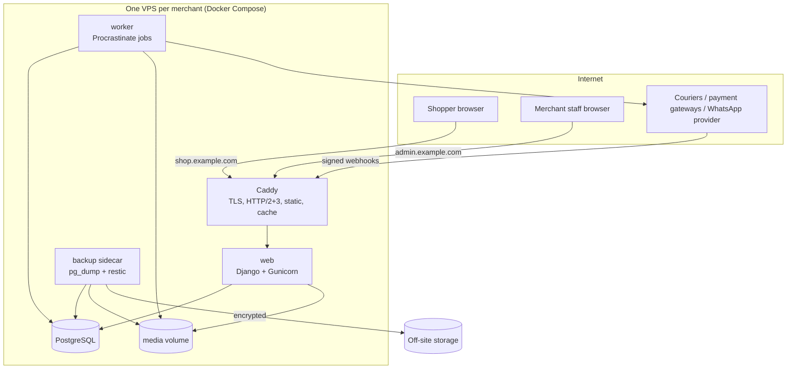
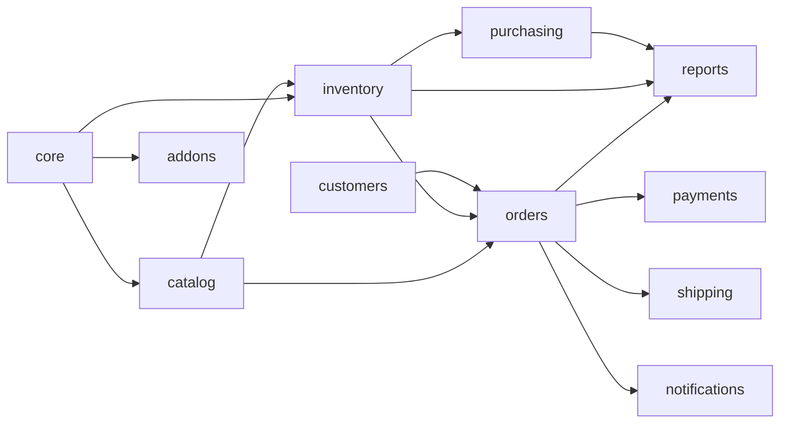

# 002 — Architecture and Deployment

## 1. Style: modular monolith, one stack per merchant

One Django codebase, strict module boundaries, one isolated deployment per merchant. This gives full data isolation, simple debugging, and the option to move hot paths to another language later without a rewrite.



### Why these choices

| Choice | Reason |
|---|---|
| Django modular monolith | Admin, auth, ORM, migrations and i18n come built in; one codebase to secure |
| PostgreSQL only | Data, job queue (Procrastinate), search (full-text) and cache tables in one engine; fewer moving parts per client |
| No Redis in v1 | Fewer containers per install. Add it only if a measured need appears |
| Procrastinate | Postgres-backed task queue; no broker |
| HTMX + Tailwind | Server-rendered pages with small, targeted interactivity; Tailwind via standalone CLI at build time, no Node at runtime |
| Caddy | Automatic TLS, simple config, HTTP/3, easy micro-caching of anonymous pages |
| Docker Compose per client | Matches the "host independently" goal; trivial to back up, move, or hand over |

## 2. Hostnames and surfaces

| Surface | Hostname | Audience | Notes |
|---|---|---|---|
| Storefront | `shop.<domain>` or apex | Shoppers | SSR, cacheable |
| Dashboard | `admin.<domain>` | Staff | Same codebase, separate URL conf and cookies |
| API (v1, optional) | `api.<domain>` | Add-ons, mobile app | Django REST Framework, token or session auth |
| Webhooks | `shop.<domain>/hooks/<provider>/` | Gateways, couriers | Signed, idempotent, rate limited |

The dashboard uses a **separate session cookie name and domain scope** from the storefront so a storefront XSS cannot ride a staff session.

## 3. Repository layout

```
djet-store/
├── apps/
│   ├── core/            # base models, money, audit log, settings model, feature flags
│   ├── catalog/
│   ├── inventory/
│   ├── customers/
│   ├── orders/
│   ├── payments/
│   ├── shipping/
│   ├── purchasing/
│   ├── notifications/
│   ├── reports/
│   ├── dashboard/       # staff UI
│   ├── storefront/      # shopper UI
│   ├── presets/         # vertical presets (data + code)
│   └── addons/          # optional apps, each self-contained
├── config/
│   ├── settings/{base,dev,prod,test}.py
│   ├── urls_storefront.py
│   ├── urls_dashboard.py
│   └── asgi.py / wsgi.py
├── deploy/
│   ├── compose.yml
│   ├── Caddyfile
│   ├── backup/
│   └── install.sh
├── docs/
├── samples/
├── tests/
└── pyproject.toml
```

## 4. Module boundaries



Rules:

- Arrows mean "may import from". No cycles.
- Cross-app communication that would create a cycle goes through **signals or service functions** declared in the target app's `services.py`.
- Views never touch another app's models directly; they call that app's service layer.
- Add-ons may import from core apps. Core apps never import from `addons`.
- Enforce with an import-linter contract in CI.

## 5. Runtime details

| Concern | Decision |
|---|---|
| Web server | Gunicorn with a small number of sync workers and threads; tune per VPS size |
| Static files | Built at image build time, served by Caddy with long-lived immutable caching (hashed names) |
| Media | Volume-mounted; image variants generated by the worker (phase 005) |
| Caching | Caddy micro-cache for anonymous GETs (seconds to minutes), Django per-view and fragment cache for catalogue, invalidated on product/stock change |
| Search | PostgreSQL full-text with trigram index, Arabic and English configurations. Revisit only if measured slow |
| Time zone | `Africa/Cairo` default, stored in UTC |
| Locale | `ar` and `en`, RTL support, Arabic-Indic digits optional per merchant |
| Email | SMTP via provider credentials in environment |
| Secrets | Environment file with 0600 permissions, never in the repo; see phase 014 |

## 6. Configuration model

Two layers:

1. **Environment** (deployment-time): database URL, secret key, allowed hosts, provider credentials, domain names.
2. **`StoreSettings` row** (run-time, editable in dashboard): store name, logo, currency, languages, tax mode, enabled add-ons, theme tokens, shipping zones, notification templates.

Never put merchant-editable values in environment variables and never put secrets in `StoreSettings`.

## 7. Multi-tenancy position

v1 is **single-tenant per install**. Do not add tenant IDs to tables. If a hosted multi-tenant SaaS is ever wanted, it will be a separate product decision with its own blueprint. Keep global state out of module-level variables so that a future change stays possible.

## 8. Tasks in this phase

1. Create the layout above with empty apps registered in settings.
2. Write `deploy/compose.yml` with services: `web`, `worker`, `db`, `caddy`, `backup`.
3. Write the `Caddyfile` for two hostnames with TLS, security headers, gzip/zstd, static and media routes.
4. Add settings modules, environment parsing, and a `.env.example`.
5. Add `import-linter` contracts matching section 4.
6. Add CI (lint, type check, tests, import contracts, build the image).
7. Add a health endpoint `/healthz` (DB reachable, migrations applied) and a readiness endpoint for the worker.

## 9. Definition of done (phase 002)

- [ ] `docker compose up` brings the full stack up locally with HTTPS on local hostnames.
- [ ] Storefront and dashboard are served on separate hostnames with separate cookies.
- [ ] Import-linter fails the build if a forbidden import is introduced.
- [ ] `/healthz` returns structured JSON and is used by the compose healthcheck.
- [ ] `PHASE-002-REPORT.md` written.
