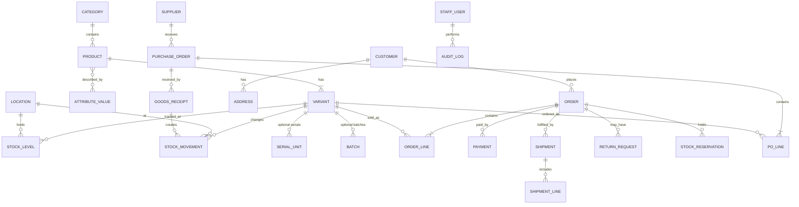
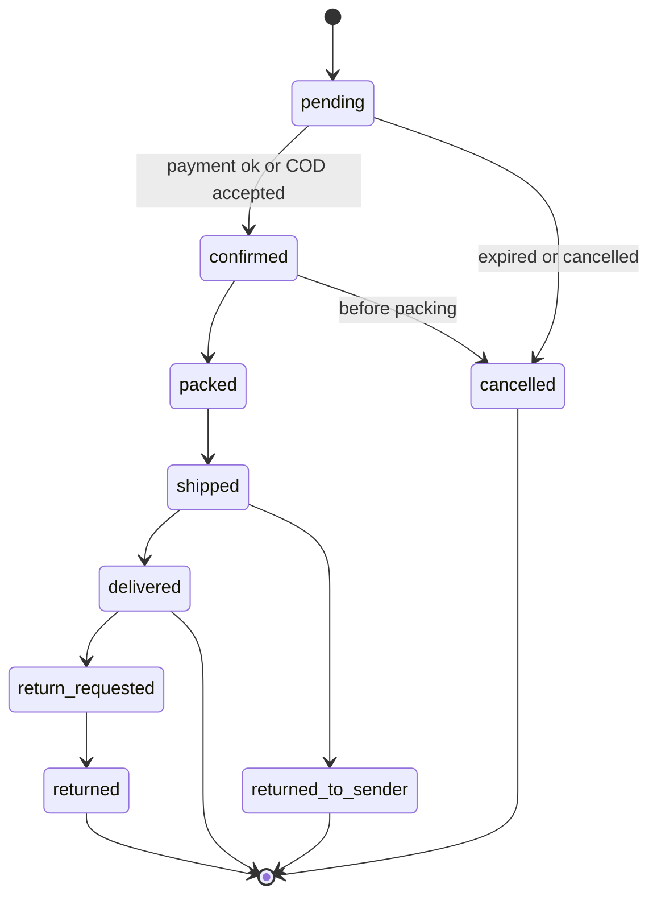

# 003 — Domain Model and the Stock Ledger

## 1. Entity overview



## 2. Money rules

- Store money as **integer minor units** (`BigIntegerField`). EGP piastres: 12,999.50 EGP is `1299950`.
- Wrap in a `Money` value object in `core.money` with currency code. Arithmetic across different currencies raises.
- Never use `float`. Rounding mode is **half-up**, applied once per line, at a defined step (see below).
- Tax: v1 supports `none`, `inclusive` and `exclusive` per merchant, one rate per product class. Compute at line level; store computed tax on the line so historical orders never change.
- Store on each order line: `unit_price`, `unit_cost_snapshot`, `tax_amount`, `discount_amount`, `line_total`. Snapshots make reports correct when prices change later.
- Display formatting (separators, Arabic digits, symbol position) belongs to the template layer only.

## 3. Identifiers

- Public IDs (order numbers, SKUs) are human-friendly and **not sequential integers exposed to shoppers**. Orders: `DJ-` plus a short random base32 plus a check character. Internal primary keys can be `BigAutoField`.
- SKUs are merchant-defined, unique per variant, case-insensitive.
- Phone numbers are stored in **E.164**; Egyptian mobile input like `010…` is normalised on write.

## 4. The stock ledger (the most important design in the product)

### Principles

1. `StockMovement` is **append-only**. No updates, no deletes. Corrections are new movements.
2. `StockLevel` (per variant per location) is a **derived cache** updated in the same transaction as the movement, never edited by hand.
3. Every movement has a **reason code**, a **reference** (order, PO, adjustment document) and an **actor**.
4. Reservations are separate from movements: `on_hand` changes only when goods physically move; `reserved` changes when an order holds stock.
5. `available = on_hand − reserved`. Checkout checks `available`.

### Tables (simplified)

```
stock_movement
  id, variant_id, location_id, quantity_delta (signed int or decimal),
  reason (enum), ref_type, ref_id, unit_cost (minor units, nullable),
  batch_id (nullable), serial_id (nullable), note,
  created_at, created_by

stock_level
  variant_id, location_id, on_hand, reserved,
  UNIQUE (variant_id, location_id)
  CHECK (on_hand >= 0)  -- unless variant.allow_negative_stock

stock_reservation
  id, order_id, variant_id, location_id, quantity, expires_at, status
```

### Reason codes

| Reason | Sign | Typical reference |
|---|---|---|
| `purchase_receipt` | + | Goods receipt |
| `sale_shipment` | − | Shipment |
| `return_restock` | + | Return request |
| `return_writeoff` | 0 (write-off record) | Return request |
| `adjustment_count` | ± | Stock count session |
| `adjustment_damage` | − | Adjustment document |
| `transfer_out` / `transfer_in` | − / + | Transfer document |
| `opening_balance` | + | Import |

### The only allowed write path

```python
# apps/inventory/services.py  (shape, not final code)
@transaction.atomic
def move_stock(*, variant, location, delta, reason, ref, actor, unit_cost=None, batch=None, serial=None):
    level = StockLevel.objects.select_for_update().get_or_create(variant=variant, location=location)[0]
    if level.on_hand + delta < 0 and not variant.allow_negative_stock:
        raise InsufficientStock(...)
    StockMovement.objects.create(...)
    level.on_hand = F("on_hand") + delta
    level.save(update_fields=["on_hand"])
```

Rules:

- Lock the `StockLevel` row (`select_for_update`) for any change.
- A nightly job **recomputes** `on_hand` from the ledger and compares. Any mismatch raises an alert and is written to the audit log. The ledger wins.
- Database-level protection: revoke `UPDATE` and `DELETE` on `stock_movement` for the application role, or add a trigger that raises. Prefer the permission approach.
- Tests must include concurrent reservation/shipment races (see phase 015).

### Costing

Default method: **weighted average cost** per variant per location, recalculated on each `purchase_receipt`. Store `unit_cost` on each movement. FIFO layers are an add-on candidate. Landed cost allocation is covered in phase 009.

## 5. Order and payment states (summary, detail in phase 006)



## 6. Auditing

`AuditLog` records **who, what, when, from where** for every staff change to prices, stock, orders, roles, settings and exports. Append-only like the ledger. Store before/after JSON diffs for model changes. Retention is a merchant setting with a safe default.

## 7. Tasks in this phase

1. Implement `core.money.Money` with full unit tests (rounding, currency mismatch, formatting hooks).
2. Implement base models: `TimeStamped`, `AuditedModel`, `AuditLog`, `StoreSettings`, `FeatureFlag`.
3. Implement `inventory` models and the `move_stock` service with all reason codes.
4. Implement reservation creation, expiry job and release.
5. Add DB protections for `stock_movement` immutability.
6. Add the nightly reconcile job with alerting hook.
7. Write migrations and a seed command using `samples/stock_opening_balance.csv`.

## 8. Definition of done (phase 003)

- [ ] No code outside `inventory.services` can change `on_hand` (verified by a test that greps and by DB permissions).
- [ ] Concurrency test: 50 parallel purchase attempts against 10 units never oversell.
- [ ] Reconcile job detects a deliberately corrupted `stock_level` row in a test.
- [ ] Money tests cover rounding at every tax mode.
- [ ] `PHASE-003-REPORT.md` written.
