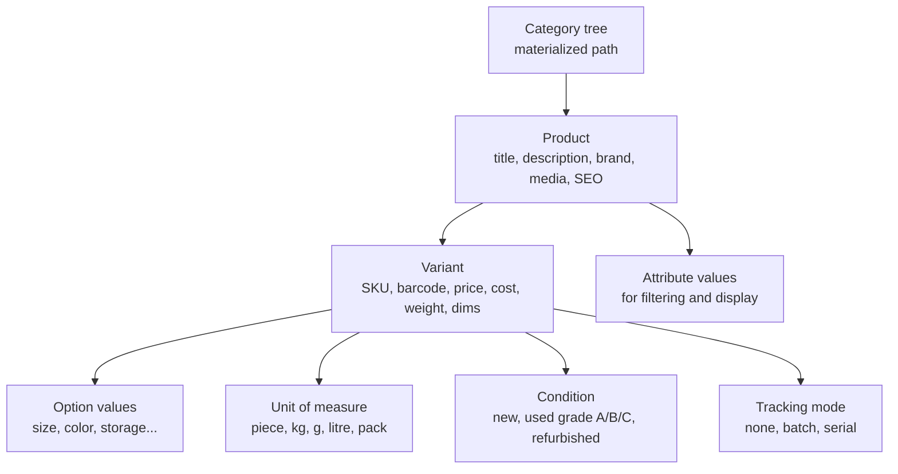

# 004 — Catalog and Inventory

## 1. Catalog model

### Key decisions

| Topic | Decision |
|---|---|
| Hierarchy | Product has one or more variants. A "simple" product has exactly one hidden default variant. All stock and prices live on variants |
| Categories | Tree via materialized path (fast subtree queries, no recursive CTE per page). Depth limit 5. Products may belong to multiple categories, with one primary |
| Attributes | Typed (text, number, choice, boolean) with a unit where numeric. Filterable flag and display group |
| Options | A product defines up to 3 option axes (e.g. size, color). Variants are the combinations that exist |
| Condition | `condition` enum on variant: `new`, `used_a`, `used_b`, `used_c`, `refurbished`. Shown clearly and filterable. Warranty text per variant |
| Units | `unit` and `unit_step` (e.g. 0.25 kg) for weight-sold items; quantity fields use `Decimal` only where the unit allows fractions |
| Barcodes | One primary barcode per variant, extra barcodes in a side table. Scan lookup is exact-match indexed |
| Media | Original upload kept, derived sizes created by the worker (phase 005). Alt text required for accessibility |
| SEO | Slug per language, meta title/description, canonical URL, structured data (JSON-LD Product with availability) |
| Pricing | `price`, optional `compare_at_price`, per-variant cost. Price lists per customer group are an add-on |
| Visibility | `draft`, `active`, `archived`, plus optional schedule (publish at) |

## 2. Inventory operations

All through `inventory.services` (phase 003). The dashboard exposes them as documents:

| Operation | Document | Ledger effect |
|---|---|---|
| Opening balance import | CSV import | `opening_balance` + per variant/location |
| Stock adjustment | Adjustment with reason and note | `adjustment_*` |
| Stock count | Count session per location, variance report, approve to post | `adjustment_count` for differences only |
| Transfer | Transfer between locations, optional in-transit state | `transfer_out` then `transfer_in` |
| Receive goods | Goods receipt against a PO (phase 009) | `purchase_receipt` |
| Write-off | Damage or expiry with approval | `adjustment_damage` |

### Reorder logic

- Each variant/location has `reorder_point` and `reorder_quantity` (optional).
- A daily job lists variants where `available <= reorder_point`.
- The dashboard shows a **Low stock** list with a one-click "create draft PO" per supplier (phase 009).
- Sales-velocity hints (average daily sales over 30 days) are shown next to each row. Do not auto-order.

### Serial and batch tracking

- `tracking_mode = serial`: every unit has a `SerialUnit` (IMEI/serial) with status `in_stock`, `reserved`, `sold`, `returned`. Receiving requires scanning or pasting serials. Shipping requires picking specific serials. A serial can be searched globally.
- `tracking_mode = batch`: `Batch` with lot code and optional expiry. Picking follows **FEFO** (first-expiry-first-out) by default.
- Both modes still write ordinary ledger movements, with `serial_id` or `batch_id` set.

## 3. Search and filtering

- Full-text search on title, SKU, barcode, brand, attribute values using PostgreSQL `tsvector` plus `pg_trgm` for typo tolerance.
- Language-aware: Arabic normalisation (alef variants, ya/alef maqsura, tashkeel removal) at index and query time.
- Filters (price range, brand, attributes, condition, in stock) must work with plain links and GET parameters so pages remain cacheable and shareable; HTMX only swaps the result region.
- Target: product list query ≤ 100 ms at 50,000 variants on the reference VPS.

## 4. Bulk operations

- CSV/XLSX **import** with a dry-run mode that reports row-level errors before committing.
- CSV **export** of products, stock levels, movements, orders.
- Bulk price change with preview (percentage or fixed, by category or brand), applied as one audited operation.
- Image bulk upload by SKU filename matching.

Sample formats: `samples/products_import.csv`, `samples/stock_opening_balance.csv`.

## 5. Use cases

| ID | As a | I want to | So that |
|---|---|---|---|
| UC-401 | Merchant | import 3,000 products from a spreadsheet and see errors before saving | I can migrate off my old platform in an afternoon |
| UC-402 | Warehouse staff | count one shelf and post only the differences | I fix stock without retyping everything |
| UC-403 | Shop owner | see which items are about to run out and create a PO | I never lose sales to stock-outs |
| UC-404 | Phone seller | receive 20 phones by scanning IMEIs | each unit is traceable for warranty |
| UC-405 | Grocer | sell cheese by weight and track expiry batches | I sell the oldest first and avoid waste |
| UC-406 | Shopper | filter used laptops by grade and price | I can compare quickly without a heavy page |

## 6. Edge cases the agent must handle

- Variant deleted while it has ledger history: **archive**, never hard-delete.
- Changing a product's option axes after variants exist: block, or provide a guided migration.
- Duplicate barcodes across variants: reject with a clear message and a link to the conflicting item.
- Importing the same CSV twice: idempotent by SKU, updates only changed fields, reports "no change".
- Negative stock: only if the variant explicitly allows it (made-to-order). Otherwise reject.

## 7. Tasks in this phase

1. Models and migrations for categories, products, variants, attributes, options, units, condition, barcodes, media metadata, serial and batch.
2. Service layer for create/update with audit logging.
3. Dashboard CRUD screens for products, variants, categories, attributes (UI patterns in phase 007).
4. Importer with dry-run and the export endpoints.
5. Inventory documents: adjustment, count session, transfer.
6. Low-stock list and reorder fields.
7. Search index and Arabic normalisation, with tests using Arabic fixtures.
8. Seed command to generate a 5,000-product electronics-style catalogue including used items and serial-tracked phones.

## 8. Definition of done (phase 004)

- [ ] Importing `samples/products_import.csv` twice produces zero changes the second time.
- [ ] Stock count of 500 lines posts only variances and the ledger shows exactly those movements.
- [ ] Serial-tracked receipt and sale work end to end, and a serial cannot be sold twice.
- [ ] Search returns correct results for Arabic spelling variants in tests.
- [ ] List query at 50,000 variants meets the 100 ms target on the reference VPS profile.
- [ ] `PHASE-004-REPORT.md` written.
