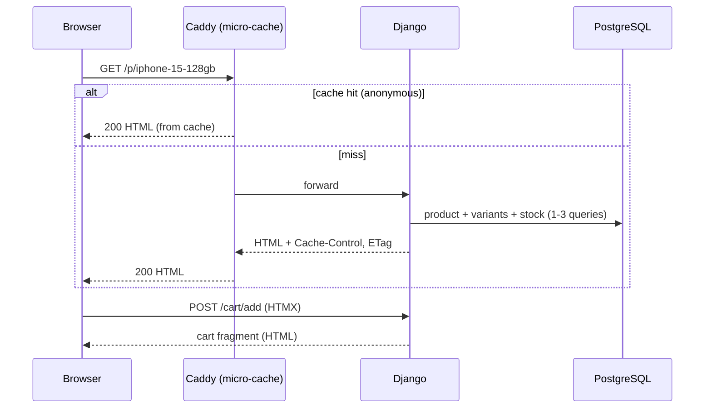
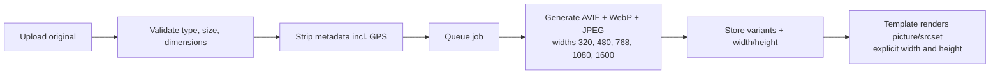

# 005 — Storefront: Performance, RTL and i18n

## 1. Approach

The storefront is **server-rendered Django templates**. HTMX provides small partial updates (variant switch, cart drawer, filters). There is no client-side router and no SPA framework. Every page works without JavaScript for browsing and for checkout via normal form posts, then gets enhanced.

## 2. Page set (v1)

Home, collection (category/brand/search/filters), product, cart, checkout (single page, steps collapsed), order confirmation, order tracking (by order number + phone), account (optional), static pages (about, policies, branches, contact), 404/500.

Guest checkout is default. Accounts are optional and phone-based (OTP via WhatsApp/SMS add-on, or email magic link).

## 3. Performance engineering rules

| Area | Rule |
|---|---|
| HTML | Compact, semantic, no inline styles, critical content in the first 14 KB where practical |
| CSS | Tailwind compiled with purge into one file ≤ 25 KB gzip, inlined critical subset optional |
| JS | HTMX (vendored, pinned) plus a small first-party file; defer everything; no jQuery, no frameworks; ≤ 40 KB gzip total |
| Fonts | Self-hosted, subset, `font-display: swap`, preload only the one used above the fold. Recommended pairing: IBM Plex Sans and IBM Plex Sans Arabic, which also matches the DJET brand type |
| Images | See section 4 |
| Third-party | None by default. Analytics: privacy-friendly self-hosted or server-side events. Merchant-added tags load after first interaction and are measured separately |
| Caching | Anonymous pages cached at Caddy for short TTL plus `stale-while-revalidate`; invalidate on product, price or stock change through a purge hook |
| Database | Query budget per page type (see below), enforced in tests with `assertNumQueries` |
| Prefetch | `<link rel=prefetch>` for likely next page on hover/touch intent, small and optional |
| Compression | Brotli or zstd at Caddy, HTTP/2 and HTTP/3 enabled |

### Query budgets (uncached)

| Page | Max queries |
|---|---|
| Home | 6 |
| Collection | 8 |
| Product | 6 |
| Cart | 5 |
| Checkout | 10 |

## 4. Image pipeline

- Validate by content sniffing, not file extension. Reject SVG uploads from staff unless sanitised.
- Always emit `width` and `height` attributes to prevent layout shift.
- First product image above the fold gets `fetchpriority="high"`; all others `loading="lazy"` and `decoding="async"`.
- Keep originals private; serve derived files only.

## 5. RTL and Arabic

- Use **CSS logical properties** (`margin-inline-start`, `padding-inline`, `inset-inline`) everywhere. Never `left`/`right` for layout.
- Set `<html lang dir>` from the active language. Test every template in both directions with screenshot tests.
- Numerals: merchant setting for Western (0-9) or Arabic-Indic (٠-٩) digits, display only. Store numbers normally.
- Currency formatting: `١٢٬٩٩٩٫٥٠ ج.م` and `12,999.50 EGP` supported through one formatter.
- Translations through Django's gettext with `.po` files. Product content translations live in a translations table keyed by language (title, description, slug, meta).
- Language switch keeps the user on the equivalent page. URL pattern: `/ar/…` and `/en/…` with `hreflang` and canonical tags.
- Fonts must cover Arabic with proper shaping; test mixed Arabic/Latin product names such as "هاتف Samsung Galaxy A17".

## 6. Accessibility

- WCAG 2.2 AA as the target: keyboard operable, visible focus, colour contrast, form labels and error summaries, `aria-live` for cart updates.
- Touch targets ≥ 44 px. Respect `prefers-reduced-motion` and `prefers-color-scheme`.
- Every interactive HTMX swap must preserve focus and announce changes.

## 7. SEO

- Clean URLs, per-language slugs, canonical and `hreflang`, XML sitemap (split when large), `robots.txt`.
- JSON-LD: `Product`, `Offer` with availability and condition (`NewCondition`/`UsedCondition`), `BreadcrumbList`, `Organization`.
- Open Graph and Twitter tags with a generated share image per product.
- Server-side redirects when a slug changes (store slug history).

## 8. Theming

- Merchants control brand through **design tokens** in `StoreSettings` (colours, radius, font pair, logo). Tokens render as CSS custom properties; no per-merchant CSS build step.
- Ship two layouts at launch (clean grid, compact list) switchable per merchant. Resist adding more until demand is real.
- A default theme must look good with zero customisation. This is the "vibe" requirement: restrained typography, generous spacing, one accent colour, fast.

## 9. Use cases

| ID | As a | I want to | So that |
|---|---|---|---|
| UC-501 | Shopper on a mid-range phone | open a product page quickly on mobile data | I do not leave |
| UC-502 | Arabic-speaking shopper | browse in a properly mirrored layout | it feels native |
| UC-503 | Shopper with JS blocked | add to cart and check out | the store still works |
| UC-504 | Merchant | change brand colour and logo without a developer | the store looks like mine |

## 10. Tasks in this phase

1. Base templates, layout, design tokens, Tailwind standalone build in the Docker build stage.
2. Home, collection, product, cart, checkout skeleton, static pages.
3. Image pipeline job and `<picture>` template tag.
4. Language and RTL support, translation tables, URL prefixes, `hreflang`.
5. Caddy micro-cache and purge hook on product/stock/price changes.
6. SEO output: sitemap, robots, JSON-LD, OG tags.
7. Lighthouse CI with the budgets from phase 001 as failing assertions.
8. Screenshot tests for LTR and RTL on the five key pages.

## 11. Definition of done (phase 005)

- [ ] Lighthouse mobile budgets from phase 001 pass on home, collection and product pages with the 5,000-product seed.
- [ ] JS and CSS size budgets enforced in CI.
- [ ] Query budgets enforced by tests.
- [ ] Browsing and add-to-cart work with JavaScript disabled.
- [ ] RTL screenshot tests pass with no layout breakage.
- [ ] `PHASE-005-REPORT.md` includes measured numbers.
