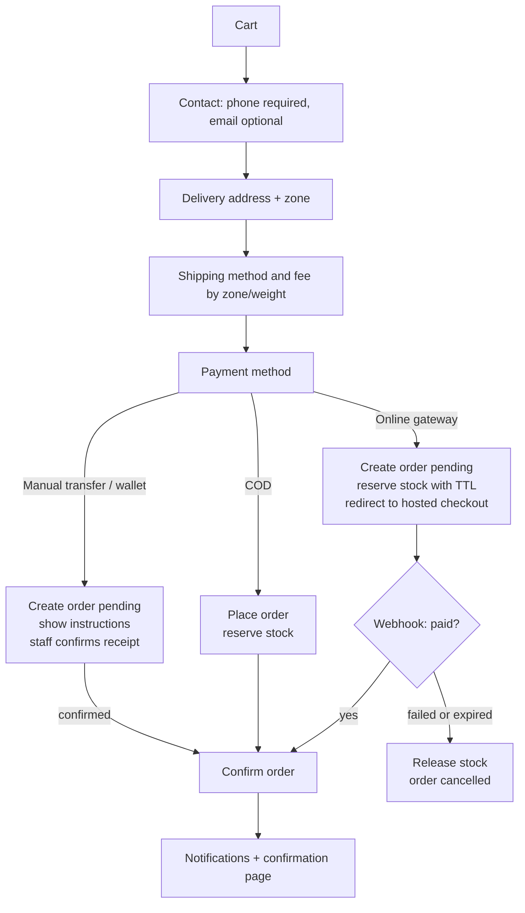
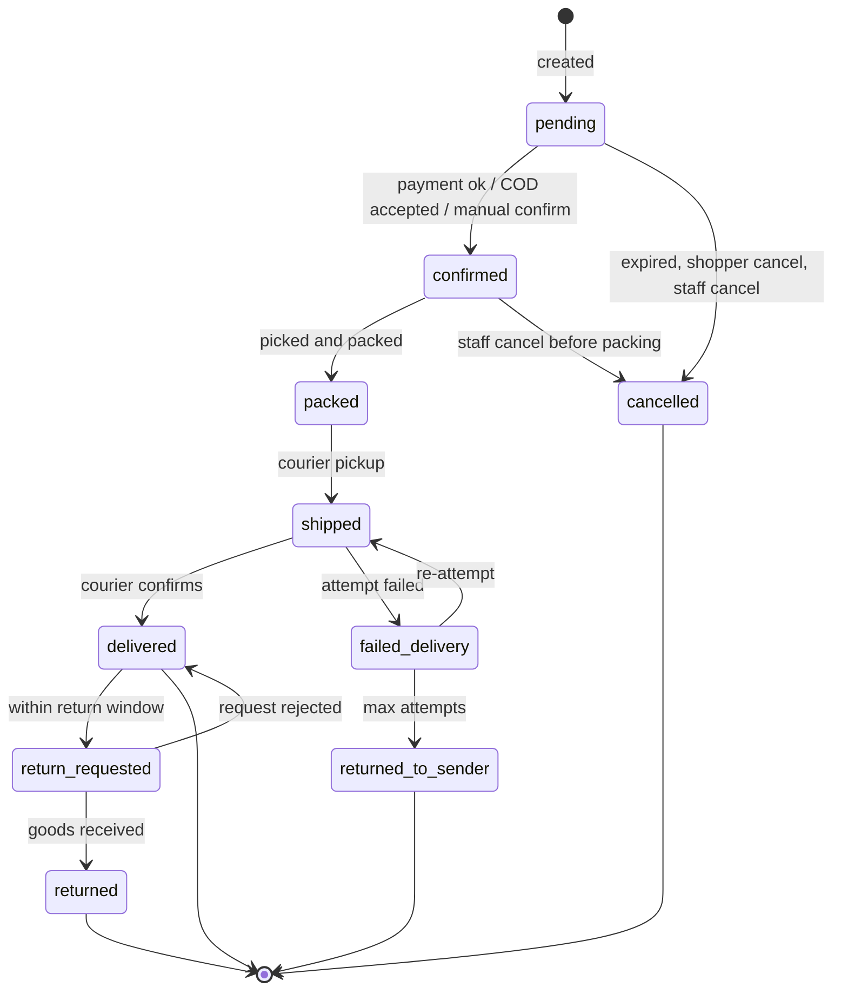
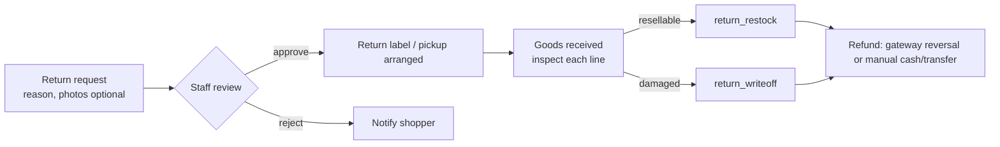

# 006 — Orders, Checkout and COD

## 1. Cart

- Cart is server-side, keyed by a signed cookie for guests and by customer for logged-in users. Guest cart merges on login.
- Cart lines hold `variant_id`, `quantity`, and a **price snapshot only at checkout**, not in the cart. Prices shown in the cart are always live.
- Cart does **not** reserve stock. Stock is reserved when checkout starts a payment attempt or when a COD order is placed.
- Limits: max distinct lines and max quantity per line are merchant settings, with sane defaults to deter abuse.

## 2. Checkout flow

### Checkout rules

1. Single page, progressively enhanced. Each section validates server-side; HTMX only swaps sections.
2. **Phone is the primary identity.** Normalise to E.164, require a plausible Egyptian mobile pattern when country is Egypt.
3. Address model: governorate, city/district, street, building/apartment, landmark note, optional map pin. Governorate and city come from a maintained list used for shipping zones.
4. Re-validate price, availability and shipping fee **on submit**, inside the transaction that creates the order. If anything changed, show a clear message and stop.
5. **Idempotency:** each checkout carries a token; double-clicks and retries never create two orders.
6. Order total is computed once by a single `pricing.calculate(cart, address, method)` function used by both preview and submit. No duplicated maths in templates or JS.
7. Anti-abuse for COD: rate limit by IP and phone, optional "confirm by WhatsApp/SMS" step for first-time COD orders above a threshold (add-on friendly), blocklist for repeated refusals.

## 3. Order lifecycle

Implementation:

- State is an enum on `Order` with a **transition table** in code. Each transition is a service function (`orders.services.confirm(order, actor)`) that validates, performs side effects (ledger, notifications), writes an `OrderEvent` and an audit entry. Views never set `order.status` directly.
- Every state change emits a Django signal (`order_status_changed`) that notifications and add-ons subscribe to.
- `OrderEvent` is append-only and shown as the timeline in the dashboard.

### Stock interaction by transition

| Transition | Stock effect |
|---|---|
| `pending` created | Reserve (with TTL for online payment) |
| `pending → confirmed` | Reservation becomes firm |
| `→ cancelled` | Release reservation |
| `confirmed → packed` | No ledger change |
| `packed → shipped` | `sale_shipment` movements; reservation consumed |
| `→ returned` | `return_restock` or `return_writeoff` per line inspection |
| `shipped → returned_to_sender` | `return_restock` after inspection |

## 4. Order data (snapshot rules)

On order creation, copy and freeze: customer contact, address, shipping method name and fee, each line's title, SKU, options, condition, unit price, cost snapshot, tax, discounts. Later catalogue edits never rewrite past orders.

## 5. Discounts (v1 scope)

Keep small and correct:

- Coupon codes: percentage or fixed, minimum subtotal, usage limits, date window, optional free shipping.
- Automatic compare-at price display (not a discount engine).
- A full promotions engine (BOGO, bundles, tiered, customer-group pricing) is an add-on (phase 012).

## 6. Returns and refunds

- Return window and reasons are merchant settings.
- Refunds record method, amount, reference. Partial refunds supported per line.
- Used-condition items may have a different return policy; support policy text per condition.

## 7. Order numbers and tracking

- Public order number format from phase 003. Tracking page requires **order number plus phone** to avoid enumeration. Rate limit lookups.
- Timeline on the tracking page shows only shopper-safe events.

## 8. Use cases and acceptance scenarios

| ID | Scenario | Expected |
|---|---|---|
| UC-601 | Shopper double-clicks "Place order" | Exactly one order is created |
| UC-602 | Last unit bought by two shoppers at once | One succeeds, the other sees an out-of-stock message before payment |
| UC-603 | Gateway payment never completes | Order expires, stock released within the TTL window |
| UC-604 | Staff cancels a packed order | Reservation released, shopper notified, audit entry written |
| UC-605 | Price changes between cart and submit | Shopper sees updated total and must confirm |
| UC-606 | COD order refused at the door | State to `returned_to_sender`, stock restocked after inspection, phone flagged |
| UC-607 | Partial return of a 3-line order | Only returned lines restock; partial refund recorded |

## 9. Tasks in this phase

1. Cart service and views (HTMX fragments plus non-JS fallback).
2. Pricing service with tests for every tax mode, coupons, shipping fee.
3. Checkout views, address model, governorate/city dataset and shipping zone matching.
4. Order models, transition table, services, `OrderEvent`, signals.
5. Reservation TTL job.
6. Coupons model and validation.
7. Return request flow and refund records.
8. Order tracking page with rate limiting.
9. Staff-side order list and detail (UI in phase 007).

## 10. Definition of done (phase 006)

- [ ] All scenarios UC-601 to UC-607 have automated tests.
- [ ] No view or template changes `order.status` or stock directly (checked by test and code review).
- [ ] Checkout works with JavaScript disabled.
- [ ] Idempotency test: replaying the same submit 20 times yields one order.
- [ ] `PHASE-006-REPORT.md` written.
