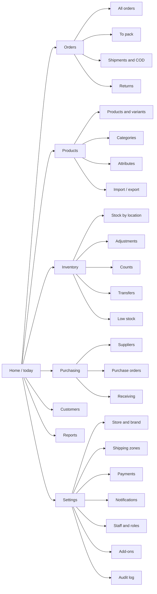

# 007 — Dashboard and Role-Based Access

## 1. Principles

- The dashboard is a **separate surface** (`admin.<domain>`) of the same codebase, with its own URL conf, session cookie and CSRF scope.
- Built with Django templates, HTMX and the same design tokens as the storefront, tuned for dense data: tables, filters, bulk actions, keyboard shortcuts.
- Do **not** expose Django's built-in `/admin` to merchants. Keep it for DJET support, bound to a separate hostname or an allow-listed network, and disabled by default in `prod` settings.
- Arabic and English with RTL, same as the storefront.

## 2. Navigation map

### "Today" home screen

Cards that answer the owner's morning questions: orders to pack, COD awaiting payout, low-stock count, sales today vs. same weekday last week, failed deliveries needing action. Each card links to the filtered list. Keep it to one query-light page.

## 3. Roles and permissions

Permissions are explicit strings (`orders.view`, `orders.cancel`, `inventory.adjust`, `catalog.edit_price`, `purchasing.approve`, `reports.view_costs`, `settings.edit`, `staff.manage`, `audit.view`, `data.export`). Roles are bundles of permissions. Do not scatter `if user.is_superuser`.

| Role | Intended for | Key permissions |
|---|---|---|
| Owner | Merchant owner | Everything, including `staff.manage`, `settings.edit`, `data.export` |
| Manager | Operations lead | Orders, catalogue, inventory, purchasing, reports; no staff or payment settings |
| Cashier / Sales | Front desk | Create and view orders, limited discounts, no costs or margins |
| Warehouse | Stock handling | Pick/pack, receive, count, transfer; no prices or customer contact export |
| Accountant | Finance | Read orders, payouts, COD reconciliation, costs and exports; no stock or catalogue edits |
| Support | Customer help | View orders and customers, update contact notes, start returns |

Rules:

- Roles can be customised per install. Built-in role definitions are re-applied by migration but never override merchant edits silently.
- **Sensitive fields are permission-gated**: cost, margin, supplier prices, customer phone export.
- Permission checks happen in services as well as views, so API and background code cannot bypass them.
- Staff accounts: required **2FA (TOTP)** for Owner and Manager; strongly encouraged for all. Recovery codes. Session timeout and device list. See phase 014.

## 3.1 Approval flows

Optional, merchant-configurable, off by default:

- Purchase orders above a value need approval.
- Stock write-offs above a value need approval.
- Price changes beyond a percentage need approval.

## 4. Screen standards

| Element | Standard |
|---|---|
| Tables | Server-side pagination, sortable columns, saved filters, column chooser, bulk actions with confirmation, CSV export respecting permissions |
| Forms | Inline validation messages, unsaved-change warning, keyboard submit |
| Detail pages | Timeline (events + audit), related records in tabs, no more than 3 queries per tab load |
| Barcodes | Global scan box (HID scanner as keyboard) that jumps to a variant, serial or order |
| Feedback | Toasts for success; blocking messages for failures; never lose entered data |
| Destructive actions | Confirm with typed phrase for irreversible actions; prefer archive over delete |
| Mobile | Dashboard usable on a phone for packing, receiving and order lookup |

## 5. Audit log screen

Filter by actor, entity, action, date. Shows before/after diff for settings, prices, stock adjustments and role changes. Read-only for everyone including Owner. Export requires `audit.view` and `data.export`.

## 6. Use cases

| ID | As a | I want to | So that |
|---|---|---|---|
| UC-701 | Owner | add a cashier who cannot see costs | margins stay private |
| UC-702 | Warehouse staff | scan a barcode on my phone and see the pick list | packing is fast |
| UC-703 | Accountant | export last month's COD payouts | I can reconcile with the bank |
| UC-704 | Manager | see everything that changed on a product | I find who edited the price |
| UC-705 | Owner | enable 2FA for all staff | an email takeover is not enough to get in |

## 7. Tasks in this phase

1. Dashboard shell: layout, navigation, language/RTL, tokens, shared table and form components.
2. Permission system, role model, role editor, permission decorators/mixins and service-level checks.
3. Staff user management with 2FA enrolment (TOTP) and recovery codes.
4. "Today" page and the main list/detail screens for orders, products, inventory documents.
5. Global barcode search.
6. Audit log viewer.
7. Settings screens: store, brand tokens, languages, tax mode, staff and roles.
8. Disable Django `/admin` in prod and add a restricted support-access path.

## 8. Definition of done (phase 007)

- [ ] A test matrix verifies each role can and cannot perform the actions in the table above.
- [ ] Costs and margins are absent from HTML, JSON and exports for roles without `reports.view_costs`.
- [ ] 2FA is enforced for Owner and Manager.
- [ ] All list screens meet pagination and query budgets with 50,000 products and 200,000 orders in the test data set.
- [ ] `PHASE-007-REPORT.md` written.
