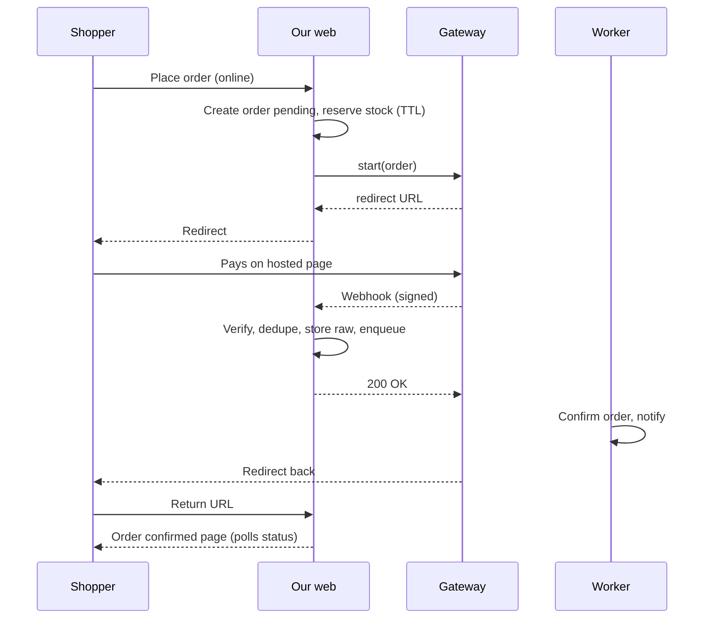
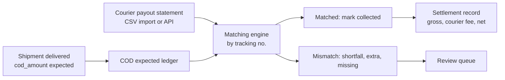

# 008 — Payments and Shipping Adapters

> **Important for the agent:** this document defines **our side** of the contracts. Request formats, authentication, webhook signatures, status codes and fees for each gateway or courier must be taken from that provider's **current official documentation** at implementation time. Do not guess endpoints or fields. If documentation or sandbox access is missing, implement the adapter against a recorded fixture and mark it `experimental` in the dashboard.

## 1. Payments

### Method catalogue (v1)

| Method | Type | Notes |
|---|---|---|
| Cash on delivery | Offline | Default; reconciled through shipping (section 3) |
| Manual bank/wallet transfer | Offline | Shopper pays outside, staff verifies receipt; supports uploading proof |
| Hosted online gateway | Online | One gateway adapter at launch, chosen with the first paying merchant; more later |

Egypt-relevant gateways and wallets exist (for example Paymob and Fawry-style services and mobile wallets). Pick the first adapter based on what the first merchants actually use and on current provider terms.

### Adapter interface

```python
# apps/payments/providers/base.py  (shape, not final code)
class PaymentProvider(Protocol):
    code: str                       # "cod", "manual", "paymob", ...
    supports_refund: bool

    def start(self, order, return_url, cancel_url) -> StartResult:
        """Create a payment session. Returns redirect URL or instructions."""

    def parse_webhook(self, request) -> WebhookEvent:
        """Verify signature, return normalised event or raise InvalidSignature."""

    def refund(self, payment, amount) -> RefundResult: ...
    def fetch_status(self, payment) -> PaymentStatus: ...   # for reconciliation
```

### Payment model

`Payment(order, provider, amount, currency, status, provider_ref, raw_payload_encrypted, created_at)` with statuses `initiated, pending, paid, failed, expired, refunded, partially_refunded`.

### Rules

1. **Hosted checkout only.** Card data never touches our servers; this keeps PCI scope minimal.
2. **Webhooks are the source of truth.** The browser return URL only shows a "processing" page and polls our order status.
3. Every webhook endpoint: verifies signature, checks timestamp window, **is idempotent** (dedupe on provider event ID), stores the raw payload, responds quickly and does work in a job.
4. Amount and currency from the webhook must equal the order's expected amount; mismatches flag the order for review, never auto-confirm.
5. Provider secrets live in environment variables or an encrypted settings store, never in plain `StoreSettings`.
6. A periodic job calls `fetch_status` for `pending` payments older than N minutes to catch missed webhooks.
7. Refunds go through the adapter where supported; otherwise record a manual refund with method and reference.



## 2. Shipping

### Concepts

- **Zones:** sets of governorates/cities with a rate table.
- **Rates:** flat, by weight band, by order value, free-over threshold. Delivery-time estimate text per zone.
- **Methods:** courier delivery, store pickup (per location), same-day (merchant-defined).
- **Package data:** variant weight and dimensions roll up to a shipment weight; merchants can override.

### Courier adapter interface

```python
class CourierProvider(Protocol):
    code: str                        # "manual", "bosta", "aramex", "mylerz", ...

    def quote(self, shipment) -> list[Quote]: ...            # optional
    def create(self, shipment) -> CreateResult:              # returns tracking no., label URL
        ...
    def cancel(self, shipment) -> None: ...
    def track(self, shipment) -> list[TrackingEvent]: ...
    def parse_webhook(self, request) -> list[TrackingEvent]: ...
```

### Shipment model

`Shipment(order, courier, tracking_no, status, weight, cod_amount, cod_status, label_ref, created_at)` and `ShipmentLine(shipment, order_line, quantity, serial/batch)`.

Normalised shipment statuses: `created, picked_up, in_transit, out_for_delivery, delivered, failed_attempt, returning, returned, cancelled`. Each adapter maps its own statuses into these.

### Rules

- A **manual courier** adapter ships in v1: staff enters a tracking number and updates status by hand. It guarantees the product works for any courier before specific adapters exist.
- Tracking updates arrive by webhook or by a scheduled poll job with backoff; both write the same `TrackingEvent` rows.
- Webhooks follow the same signature, idempotency and raw-storage rules as payments.
- Partial shipments are supported (several shipments per order).

## 3. COD reconciliation (a core differentiator)

Couriers collect cash and pay merchants later, often in batches and net of fees. Merchants lose track of it.



- `CodExpected` rows are created when a COD shipment is marked delivered.
- Import courier payout statements (CSV/XLSX or API) into a `CourierSettlement` with lines; auto-match by tracking number and amount.
- Dashboard shows: expected, collected, outstanding (with age), disputed, and courier fees. Sort outstanding by age to chase the oldest first.
- Reports (phase 010) include per-courier performance: delivery rate, return rate, average days, fees.

Sample statement format: `samples/courier_settlement.csv`.

## 4. Use cases

| ID | As a | I want to | So that |
|---|---|---|---|
| UC-801 | Merchant | accept COD only | I can launch with no gateway account |
| UC-802 | Merchant | see COD cash the courier still owes me, by age | I chase the oldest payments |
| UC-803 | Shopper | pay by card on a hosted page | my card data is never on the store |
| UC-804 | Support | see the courier's tracking history inside the order | I answer "where is my order" without leaving |
| UC-805 | Merchant | import a courier's payout CSV | reconciliation takes minutes |

## 5. Tasks in this phase

1. Payments app: models, provider registry, adapter interface, COD and manual-transfer adapters.
2. Webhook framework: signature verification helper, idempotency store, raw payload storage (encrypted), job dispatch.
3. First online gateway adapter, behind a feature flag and sandbox settings.
4. Shipping app: zones, rate engine, methods, shipment models, manual courier adapter.
5. Tracking events and polling job with backoff.
6. COD expected, settlement import, matching engine, review queue and aging report.
7. Dashboard screens for payments, shipments, COD and settlements.
8. Contract tests for adapters using recorded fixtures; replay tests for webhooks including duplicates and out-of-order events.

## 6. Definition of done (phase 008)

- [ ] Store can run end to end with COD and the manual courier only.
- [ ] Webhook replay and duplicate tests pass for every adapter.
- [ ] Amount-mismatch webhook never auto-confirms an order.
- [ ] A sample courier statement imports and matches with a reported match rate and a review queue for the rest.
- [ ] Adapter docs in `docs/adapters.md` explain how to write a new one in under a day.
- [ ] `PHASE-008-REPORT.md` written.
