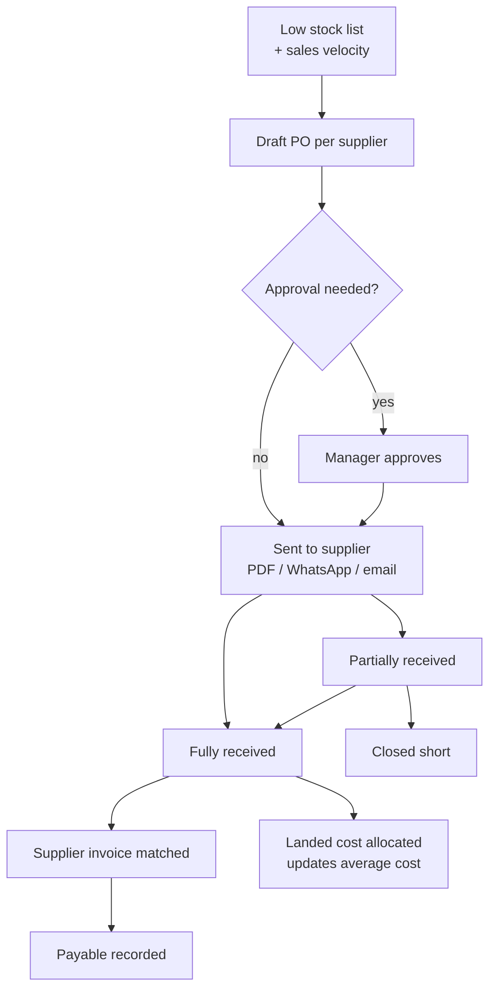

# 009 — Purchasing and Suppliers

This is the half of the product that Shopify-style stores rarely do well and where merchants lose money quietly.

## 1. Flow

## 2. Entities

| Entity | Key fields |
|---|---|
| Supplier | name, contact, phone/WhatsApp, payment terms (days), currency, lead time days, notes, active |
| SupplierItem | supplier, variant, supplier SKU, last cost, min order quantity, pack size |
| PurchaseOrder | number, supplier, location (deliver to), status, expected date, currency, subtotal, extra costs, notes |
| POLine | variant, quantity ordered, unit cost, tax, quantity received |
| GoodsReceipt | PO, received at, received by, lines (qty, serials/batches), notes, attachments |
| SupplierInvoice | supplier, number, date, total, matched receipts, due date, status |
| LandedCost | receipt, kind (freight, customs, handling), amount, allocation basis |

PO statuses: `draft, awaiting_approval, sent, partially_received, received, closed, cancelled`.

## 3. Rules

1. **Receiving is the only thing that changes stock** (via `purchase_receipt` ledger movements). Creating or sending a PO never touches `on_hand`. The dashboard may show "incoming" quantity from open POs as a separate informational figure.
2. Partial receipts are normal. Over-receipt beyond a tolerance percentage requires approval.
3. Serial/batch variants require entering serials or batch/expiry at receipt.
4. **Landed cost:** extra costs (freight, customs, handling) allocate across receipt lines by value, weight or quantity (merchant chooses). Final unit cost updates the weighted average cost through the ledger's `unit_cost`.
5. Supplier price history is stored; show the last 5 costs and a flag when a new cost jumps more than a configured percentage.
6. Multi-currency POs: store currency and an exchange rate at receipt; costs convert to the store currency at that rate and the rate is kept for audit.
7. Supplier invoice matching: three-way match (PO, receipt, invoice) with tolerance; mismatches go to a review queue.
8. Every status change is audited and timestamped; documents are immutable once `sent`, changes create revisions.

## 4. Reorder suggestions

- Daily job computes for each variant/location: available, incoming from open POs, 30/60-day average daily sales, lead time, safety stock.
- Suggested quantity = `max(0, velocity × (lead_time + review_period) + safety − available − incoming)`, rounded up to pack size and min order quantity.
- Show suggestions grouped by preferred supplier; one click creates draft POs. The system suggests; a human approves.
- Document the formula and its limits (seasonality, promotions) in the UI help text.

## 5. Outputs

- PO as a clean **PDF** (bilingual, supplier-facing) generated server-side; share by email or a WhatsApp message with a link or file.
- Goods receipt printout with barcodes/serial list.
- Supplier statement: open POs, received-not-invoiced, invoiced-unpaid, aging.

## 6. Use cases

| ID | As a | I want to | So that |
|---|---|---|---|
| UC-901 | Owner | see suggested reorders grouped by supplier | I order in minutes |
| UC-902 | Warehouse | receive half a PO today and the rest later | stock matches the truck |
| UC-903 | Accountant | allocate freight and customs across items | costs and margins are true |
| UC-904 | Manager | be alerted when a supplier raises a price by more than 10% | I can negotiate or switch |
| UC-905 | Owner | see how much I owe suppliers and when | I manage cash flow |

## 7. Tasks in this phase

1. Models and migrations for suppliers, supplier items, POs, receipts, invoices, landed costs.
2. PO lifecycle services with approvals and revisions.
3. Receiving UI with scanner support and serial/batch capture.
4. Landed-cost allocation and weighted-average cost update through the ledger.
5. Reorder suggestion job and screen.
6. PO PDF generation (Arabic and English, RTL-correct).
7. Supplier statement and payables aging.
8. Import for supplier items and cost lists.

## 8. Definition of done (phase 009)

- [ ] A partially received PO updates stock correctly and leaves the PO open with remaining quantities.
- [ ] Landed cost allocation test cases (value, weight, quantity) match hand-computed fixtures.
- [ ] No code path other than goods receipt increases stock from purchasing.
- [ ] PO PDF renders Arabic correctly in a visual test.
- [ ] `PHASE-009-REPORT.md` written.
