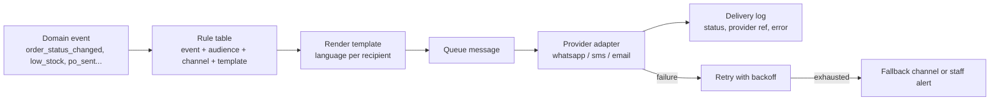

# 010 — Notifications and Reports

## 1. Notifications

### Channels

| Channel | Use | Notes |
|---|---|---|
| WhatsApp | Primary for order updates in the target market | Through an official provider; see compliance notes |
| SMS | Fallback and OTP | Provider adapter, cost-aware |
| Email | Receipts, staff alerts, PO documents | SMTP |
| In-dashboard | Staff alerts (low stock, failed webhook, COD aging) | Always on |

### Architecture



- Events are Django signals emitted by services (phase 006 onwards). Notifications subscribe; services never call notification code directly.
- Templates are stored in the database, editable in the dashboard, **per language**, with variables (`{order_number}`, `{tracking_link}`) validated on save and a preview with sample data.
- Each message is idempotent on `(event_id, recipient, channel)`.
- Respect opt-out: shoppers can opt out of marketing; transactional messages are always allowed but minimal.
- Rate-limit per recipient and per install to prevent runaway sends.

### Provider adapter interface

```python
class MessageProvider(Protocol):
    channel: str
    def send(self, message) -> SendResult: ...
    def parse_webhook(self, request) -> list[DeliveryEvent]: ...   # delivery receipts
```

### WhatsApp notes (read before building)

- Business-initiated WhatsApp messages generally require **pre-approved templates** through an official Business API provider and carry per-message costs. Confirm current rules, pricing and approval times with the chosen provider before promising features to merchants.
- Unofficial/self-hosted gateways exist and are tempting for cost reasons, but they can break and can put the merchant's number at risk of being banned. If one is ever offered, label it clearly as unsupported and keep it out of the default install.
- Keep message content transactional and short. Always include the store name.

### Default transactional set

Order received, order confirmed, shipped (with tracking), out for delivery, delivered, delivery failed (with action), return approved, refund issued. Staff alerts: low stock, COD overdue, webhook failures, nightly reconcile mismatch, backup failure.

## 2. Reports

Philosophy: a small set of **trustworthy** reports beats a large dashboard of vanity charts. Every number must reconcile to the ledger or order data and show how it is computed.

| Report | Answers | Source of truth |
|---|---|---|
| Sales summary | Revenue, orders, average order value, by day/week/month, channel, payment method | Orders (snapshots) |
| Gross margin | Revenue minus cost snapshot, by product, category, brand | Order lines (cost snapshot) |
| Best and worst sellers | What moves, what sits | Order lines |
| Stock valuation | Value of stock by location at cost, as of a date | Ledger |
| Stock ageing | How long units have been on hand; dead stock list | Ledger |
| Inventory movement | Everything that changed for a variant in a period | Ledger |
| Reorder status | Stock-out risk and suggestions | Phase 009 job |
| COD outstanding | Cash owed by couriers, aged | Phase 008 |
| Courier performance | Delivery rate, returns, days, fees | Shipments |
| Returns analysis | Rate and reasons by product and courier | Returns |
| Purchases and payables | Spend by supplier, open POs, aging | Purchasing |
| Customer summary | New vs returning, top customers | Orders |

### Rules

- Reports read from **query views or summary tables** refreshed by jobs, not from ad-hoc heavy joins at request time. Budget: any report screen under 2 seconds on the 200,000-order data set.
- Every report has date range, location filter, CSV export, and an "about this report" drawer with the definition and the SQL/ORM logic summary.
- Cost-related reports require `reports.view_costs`.
- Timezone-correct day boundaries (`Africa/Cairo`).
- Reconciliation checks run nightly: sum of order totals equals sum of payments plus COD expected; stock valuation equals the ledger sum. Failures alert staff.

## 3. Use cases

| ID | As a | I want to | So that |
|---|---|---|---|
| UC-1001 | Shopper | get a WhatsApp message when my order ships | I do not need to call |
| UC-1002 | Owner | edit the Arabic shipping message | the tone matches my brand |
| UC-1003 | Owner | see margin by category last quarter | I know where I actually make money |
| UC-1004 | Accountant | export stock valuation at month-end | I close the books |
| UC-1005 | Manager | be alerted when the nightly reconcile finds a mismatch | I catch bugs or fraud early |

## 4. Tasks in this phase

1. Notification rule table, template model and editor with preview and variable validation.
2. Email adapter and in-dashboard alerts first, then SMS and WhatsApp adapters behind flags.
3. Delivery log and retry logic; webhook handling for delivery receipts.
4. Default templates in Arabic and English for the transactional set.
5. Summary tables and refresh jobs for sales, margin, stock valuation, ageing.
6. Report screens with filters, export, and "about this report" drawers.
7. Nightly reconciliation checks with alerting.

## 5. Definition of done (phase 010)

- [ ] Every default notification fires from its event in an integration test, in both languages.
- [ ] Failed sends retry, then fall back or alert as designed.
- [ ] Each report's totals are verified against hand-built fixtures.
- [ ] Report performance targets met on the large test data set.
- [ ] `PHASE-010-REPORT.md` written.
