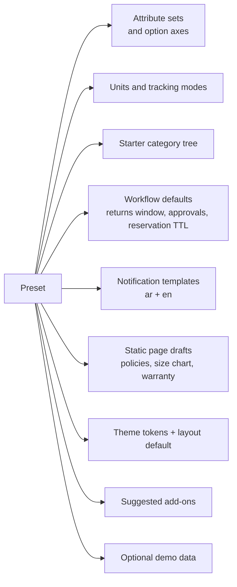
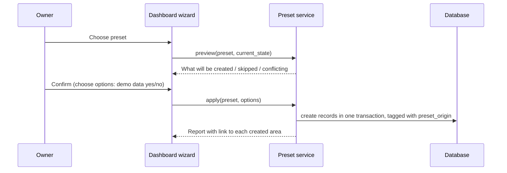

# 011 — Vertical Presets

"Easy, out of the box" is delivered by **presets**: a preset configures an install for a kind of merchant on day one, so setup takes minutes, not days.

## 1. What a preset contains



Presets are **data plus a small amount of code**, stored under `apps/presets/<code>/` as a manifest (`preset.yaml`), fixtures, and optional hooks. Applying a preset is a one-time, previewable, reversible operation (it records what it created). It never overwrites merchant data without an explicit confirmation.

### Manifest shape

```yaml
code: electronics
name: {en: "Mobile & Electronics", ar: "موبايلات وإلكترونيات"}
version: 1
defaults:
  condition_enabled: true
  tracking: {phones: serial, accessories: none}
  return_window_days: 14
  reservation_ttl_minutes: 30
  warranty_field: true
attribute_sets: [...]
categories: [...]
notification_templates: [...]
suggested_addons: [installments, compare_products]
```

## 2. Presets shipped in v1

### Electronics and mobile

| Aspect | Setup |
|---|---|
| Tracking | Serial/IMEI for phones, laptops, tablets; none for accessories |
| Condition | New, used A/B/C, refurbished, with grade descriptions |
| Attributes | Brand, model, storage, RAM, colour, screen size, warranty period, warranty type |
| Warranty | Per-variant warranty text; printed on invoice and order page |
| Extras | Compare products (add-on), installment display (add-on), trade-in notes (add-on candidate) |
| Policies | Used-goods return policy distinct from new |

### Clothing

| Aspect | Setup |
|---|---|
| Options | Size and colour axes; size chart page per category |
| Media | Several images per colour; colour swatches map to image sets |
| Tracking | None; high SKU count, so bulk import is emphasised |
| Seasonal | Collections with start/end dates; archive instead of delete |
| Returns | Longer window, exchange flow (return plus new order shortcut) |
| Extras | Size recommendation hint, low-stock badge (cheap server-side, no heavy JS) |

### Food

| Aspect | Setup |
|---|---|
| Units | kg, g, litre, piece, pack; fractional steps for weight items |
| Tracking | Batch with expiry, FEFO picking |
| Delivery | Time-slot selection, delivery cut-off times, perishables flag restricting shipping methods |
| Labels | Ingredients, allergens, storage text (display only; legal compliance is the merchant's responsibility) |
| Returns | Restricted or none for perishables, per policy text |
| Alerts | Near-expiry report, write-off workflow |

### Mini-market

| Aspect | Setup |
|---|---|
| Barcodes | Scan-first workflows; multiple barcodes per item |
| Pricing | Price per weight, pack/unit pricing, quick price updates |
| Margins | Tiny margins; reorder suggestions emphasised, low-stock alerts default on |
| Delivery | Neighbourhood zones, minimum order value, evening slots |
| Locations | Branch support; POS add-on candidate for in-store sales feeding the same ledger |
| Substitutions | Notes for picker ("if out of stock, substitute with…") |

## 3. Preset application flow



- Each created record is tagged with `preset_origin` so the preset can be reviewed or removed cleanly.
- Re-applying a newer preset version only adds missing items and lists changes; it never edits merchant-modified records.
- Presets can be combined (for example mini-market plus food) when attribute names do not conflict; conflicts are shown in the preview.

## 4. Onboarding wizard (the "easy" part)

Steps: store name and logo → language and currency → preset → locations (one is enough to start) → shipping zones (templates for Egyptian governorate groups) → payment methods (COD on by default) → notification channels → import products (CSV sample download) → publish. Target: a merchant with a spreadsheet is live in under an hour.

## 5. Use cases

| ID | As a | I want to | So that |
|---|---|---|---|
| UC-1101 | Phone shop owner | pick "Electronics" and have IMEI tracking and warranty fields ready | I do not configure it myself |
| UC-1102 | Clothing brand | import a CSV with size and colour columns | variants are generated correctly |
| UC-1103 | Grocer | have expiry tracking and FEFO enabled by default | waste drops |
| UC-1104 | DJET support | see which preset version an install uses | I can support and upgrade it |

## 6. Tasks in this phase

1. Preset framework: manifest loader, preview/apply/rollback services, `preset_origin` tagging.
2. Four presets with fixtures, translations and templates.
3. Onboarding wizard in the dashboard.
4. Shipping zone templates for Egyptian governorates.
5. Demo data generators per preset (clearly labelled, removable in one click).
6. Tests: applying each preset on a clean install, re-applying, combining, and rollback.

## 7. Definition of done (phase 011)

- [ ] Each preset applies cleanly on an empty install and passes a smoke checklist (create product, receive stock, sell, ship, report).
- [ ] Rollback removes only preset-created records.
- [ ] Wizard completes in under 15 clicks excluding data import.
- [ ] `PHASE-011-REPORT.md` written.
