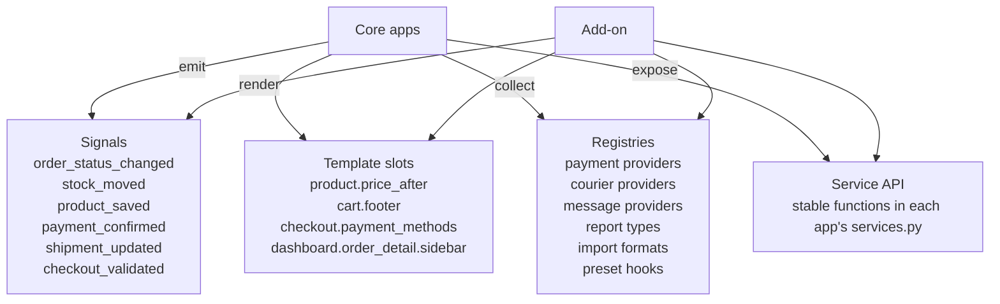

# 012 — Add-on System

## 1. Goal

Merchants buy a lean core and switch on extras. DJET builds add-ons without touching core code. Third-party add-ons are a possible future but **not** a v1 goal, so v1 treats add-ons as first-party and trusted.

## 2. Anatomy of an add-on

An add-on is a Django app under `apps/addons/<name>/` with a manifest.

```
apps/addons/installments/
├── addon.yaml          # manifest
├── apps.py             # AppConfig, registers hooks in ready()
├── models.py
├── migrations/
├── services.py
├── signals.py          # receivers for core signals
├── dashboard/          # views, templates, nav entries
├── storefront/         # template slot partials, views
├── api.py              # optional DRF endpoints
├── tests/
└── locale/
```

### Manifest

```yaml
code: installments
name: {en: "Installments display", ar: "عرض التقسيط"}
version: 1.2.0
requires_core: ">=1.0,<2.0"
requires_addons: []
permissions: [installments.manage]
settings_schema: settings.schema.json
nav:
  dashboard: {section: settings, label: {en: "Installments", ar: "التقسيط"}, url: "installments:settings"}
slots: [product.price_after, checkout.payment_methods]
signals: [order_status_changed]
data_removal: "docs/uninstall.md"
```

## 3. Extension points (the only ways add-ons touch core)



| Mechanism | Rule |
|---|---|
| Signals | Core emits; add-ons receive. Receivers must be fast or enqueue a job. Signals carry IDs and a small payload, not mutable core objects when avoidable |
| Template slots | A `` tag renders all registered partials in priority order, each with a cache key and a time budget |
| Registries | Provider and report registries accept new implementations declared in the add-on's `ready()` |
| Service API | Add-ons call `inventory.services.move_stock`, `orders.services.confirm`, etc. They never write core tables directly |
| Filters (value hooks) | A small set of named filter hooks for computations, such as `pricing.adjust_line`, with deterministic ordering and tests |

**Forbidden for add-ons:** monkey-patching core, editing core migrations, writing to `stock_level`, `stock_movement` or `order.status` directly, adding columns to core tables. Enforce with import-linter contracts and a CI test that scans for direct ORM writes to core models.

## 4. Enabling and disabling

- `StoreSettings.enabled_addons` lists active add-ons. Django apps for all shipped add-ons are installed, but URLs, nav, slots and signal receivers are active only when enabled. This avoids runtime `INSTALLED_APPS` mutation.
- **Enable:** check `requires_core` and `requires_addons`, run the add-on's settings wizard, record version.
- **Disable:** stops behaviour but **keeps data**. A separate, explicit "remove add-on data" action exists with a confirmation phrase and a pre-removal backup prompt.
- Add-on migrations are independent and namespaced by app label. Upgrades check compatibility before running.
- Licensing: a signed licence file per install lists entitled add-ons; absence of a licence disables the add-on without deleting data. Keep the check offline-capable and non-hostile, so a merchant is never locked out of their own data.

## 5. Add-on catalogue (candidates, in suggested priority)

| Add-on | Why merchants want it | Notes |
|---|---|---|
| Promotions engine | BOGO, bundles, tiered discounts, customer-group pricing | Uses `pricing.adjust_line` filter |
| Installments display | Common in electronics retail | Display and lead capture first; real financing integration later |
| POS (in-store) | Branches and mini-markets | Reuses catalogue and ledger; offline mode is a larger project, scope separately |
| Compare and wishlist | Expected by shoppers | Server-rendered, minimal JS |
| Loyalty points | Repeat purchases | Ledger-style points table |
| Multi-warehouse transfers (advanced) | Several branches | Builds on core transfers |
| Marketplace/social sync | Facebook/Instagram catalogue feeds | Export feeds first |
| Accounting export | Hand-off to accountants | Generic CSV first, specific formats on demand |
| Mobile app API | Companion app | Stable, versioned REST API and token auth |
| Product reviews | Social proof | Moderation queue; verified-purchase flag |
| Returns portal (advanced) | Self-service returns with labels | Extends phase 006 flow |

## 6. API surface (optional, versioned)

- Django REST Framework under `/api/v1/`, OpenAPI schema generated and published with each release.
- Auth: session for dashboard, scoped API tokens for integrations; rate limits; permission classes reuse the same permission strings as phase 007.
- Webhooks **out**: merchants can register endpoints for events (order created, shipped). Signed with HMAC and a timestamp, retried with backoff, delivery log visible.

## 7. Use cases

| ID | As a | I want to | So that |
|---|---|---|---|
| UC-1201 | DJET developer | build an add-on with no core changes | releases stay safe |
| UC-1202 | Owner | switch on an add-on from settings and configure it | I pay only for what I use |
| UC-1203 | Owner | disable an add-on without losing its data | experiments are reversible |
| UC-1204 | DJET support | see add-on versions per install | I can plan upgrades |

## 8. Tasks in this phase

1. Add-on registry, manifest loader and validator, enabled-state handling.
2. Signal catalogue with documented payloads and versioning policy.
3. Template slot tag with caching and time budget.
4. Provider and report registries; refactor existing payment/courier/message providers to register through them.
5. Filter hooks for pricing.
6. Import-linter and CI scans enforcing the forbidden list.
7. Reference add-on: **Compare and wishlist**, built only through extension points, with documentation as the template for future add-ons.
8. Licence file format and verification (offline).
9. REST API skeleton with OpenAPI output and token auth.

## 9. Definition of done (phase 012)

- [ ] The reference add-on can be enabled, disabled and data-removed without any edit to core files.
- [ ] CI fails if an add-on writes to forbidden core tables or imports forbidden modules.
- [ ] Disabling an add-on leaves core behaviour and performance unchanged (benchmark test).
- [ ] `docs/addons.md` lets a new developer build a trivial add-on in half a day.
- [ ] `PHASE-012-REPORT.md` written.
