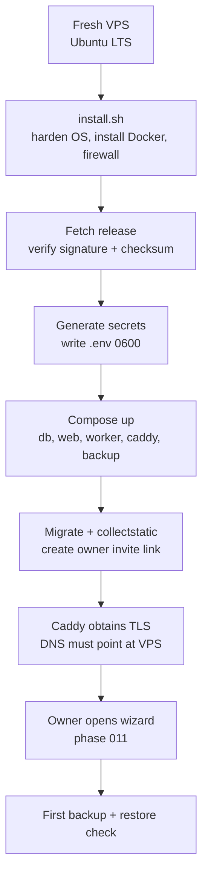
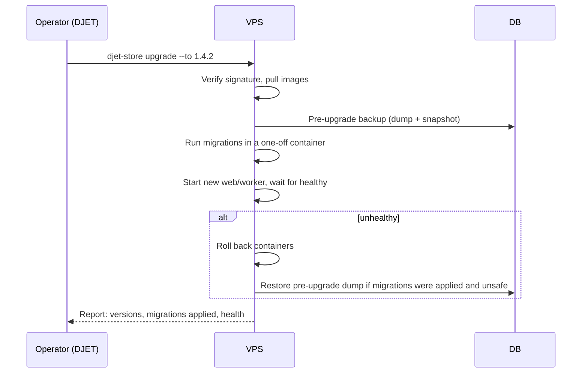

# 013 — Installer, Operations, Updates and Backups

## 1. Provisioning one merchant

Goal: a new install, with TLS and the onboarding wizard reachable, in about 15 minutes from a fresh VPS.

### `install.sh` responsibilities

- Idempotent: running twice is safe.
- OS hardening: non-root deploy user, SSH key only, firewall allowing 22 (restricted if possible), 80, 443; automatic security updates; fail2ban or equivalent; time sync.
- Install Docker and Compose from the official repository.
- Verify the release artifact (checksum and signature) before running anything from it.
- Generate secrets (Django secret key, DB password, field-encryption key) locally; **never** transmit them to DJET servers.
- Print a post-install checklist and write it to `/opt/djet-store/INSTALL-REPORT.txt`.

### Per-install inventory (DJET's own records)

Keep a private register: merchant, domain, VPS provider and region, release version, enabled add-ons, backup target, last restore test date, support contact. Store it in DJET's internal systems, not in the merchant's install.

## 2. Compose services

| Service | Image | Notes |
|---|---|---|
| `web` | App image | Gunicorn; healthcheck `/healthz`; read-only root filesystem where possible; drop capabilities; non-root user |
| `worker` | App image | Procrastinate worker; same image, different command |
| `db` | PostgreSQL | Volume; not exposed outside the compose network; tuned for small VPS |
| `caddy` | Caddy | Only service publishing ports 80/443; security headers; micro-cache |
| `backup` | Small image | Scheduled dumps + file sync with restic; encrypted; retention policy |

Resource limits per service are set so one runaway job cannot starve the web container. Provide VPS sizing guidance (tiny / small / medium) based on measured load tests from phase 015.

## 3. Updates

Rules:

- **Semantic versioning** with a changelog and migration notes. Core `1.x` keeps backwards-compatible add-on APIs; breaking changes bump the major version.
- Migrations must be **backward compatible for one release** (expand, then contract) so a rollback of code does not break on the new schema.
- Updates are operator-triggered by default. Auto-update can be an opt-in later, only for patch releases.
- Release channels: `stable` and `candidate`. DJET's own demo install always runs `candidate` first.

## 4. Backups and restore

### What is backed up

| Data | Method | Frequency | Retention (default) |
|---|---|---|---|
| PostgreSQL | `pg_dump` custom format, plus WAL archiving as a later upgrade | Daily, plus before every upgrade | 14 daily, 8 weekly, 6 monthly |
| Media files | restic snapshots | Daily incremental | Same |
| Configuration | `.env` (encrypted separately) and compose files | On change | Latest 10 |

### Rules

1. Backups are **encrypted client-side** before leaving the VPS. The key is stored with the merchant owner and DJET's escrow vault; losing it loses the backup, so test key custody during onboarding.
2. Off-site target is separate from the VPS provider account where feasible (different provider or region).
3. **A backup that has not been restored is not a backup.** Run an automated monthly restore into a scratch environment: restore, run `manage.py check`, run the reconcile job, load the storefront, report pass/fail to DJET.
4. Failures alert both DJET and the merchant (dashboard alert plus email).
5. Merchant self-service: one-click **full data export** (ZIP with CSVs, media, and a schema description) available to the Owner at any time. This supports the "yours" promise.

### Disaster recovery targets (stated to merchants)

| Scenario | Target |
|---|---|
| Restore service on a new VPS from backups | Under 2 hours with the runbook |
| Maximum data loss (RPO) | 24 hours at baseline; tighter with WAL archiving |

## 5. Monitoring and logging

- Structured JSON logs to stdout; rotated by Docker; sensitive fields redacted.
- Error tracking: self-hosted Sentry-compatible or a privacy-respecting service; scrub personal data.
- Uptime check against `/healthz` from outside the VPS; alert on failure.
- Metrics: request latency percentiles, queue depth, job failures, DB size, disk usage, backup age. Expose Prometheus-format metrics on an internal endpoint; ship alerts for disk above 80%, backup older than 36 hours, queue lag above threshold.

## 6. Runbooks (write these, short and tested)

`docs/runbooks/`: new install, upgrade, rollback, restore from backup, rotate secrets, change domain, disk full, database corruption suspicion, compromised staff account, webhook flood, courier/gateway outage, emergency read-only mode.

## 7. Use cases

| ID | As a | I want to | So that |
|---|---|---|---|
| UC-1301 | DJET operator | provision a client in 15 minutes | onboarding scales |
| UC-1302 | DJET operator | upgrade and roll back safely | updates are not scary |
| UC-1303 | Owner | download all my data | I am never locked in |
| UC-1304 | DJET operator | know a restore works every month | I trust the backups |

## 8. Tasks in this phase

1. `install.sh`, release packaging, signature and checksum verification.
2. Hardened Compose file, resource limits, healthchecks.
3. `djet-store` operator CLI: `install`, `upgrade`, `rollback`, `backup`, `restore`, `status`, `rotate-secrets`.
4. Backup sidecar with restic, retention, alerting.
5. Automated restore drill job and report.
6. Full data export feature in the dashboard.
7. Logging, error tracking and metrics wiring, alert rules.
8. Runbooks and a "fresh VPS to live store" test on a real throwaway VPS.

## 9. Definition of done (phase 013)

- [ ] A throwaway VPS goes from empty to a working HTTPS store using only the documented steps.
- [ ] Upgrade with a deliberately failing migration rolls back cleanly in a test.
- [ ] Restore drill passes on a copy of the 5,000-product, 200,000-order data set.
- [ ] Data export is complete and re-importable into a clean install.
- [ ] `PHASE-013-REPORT.md` written.
