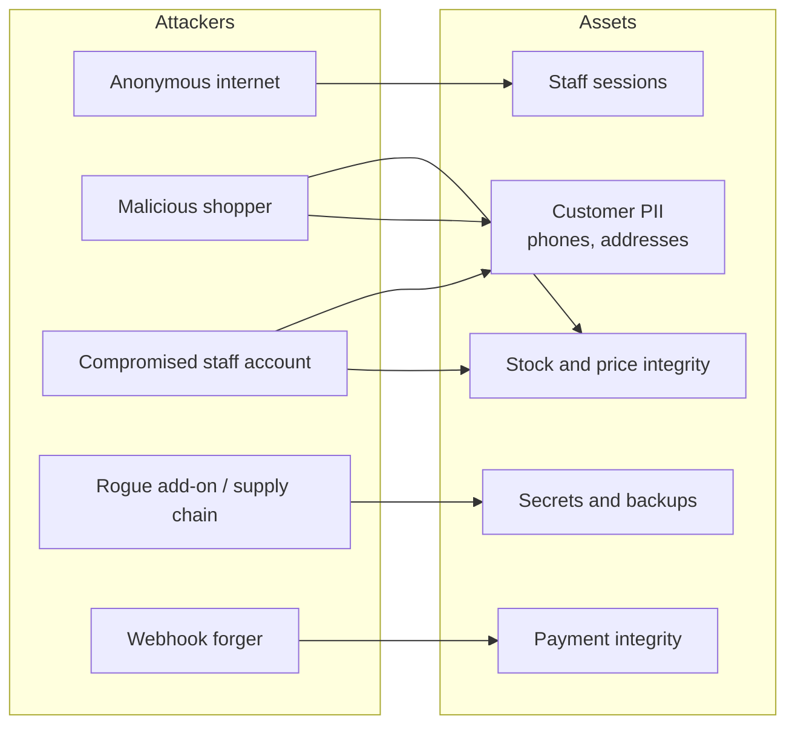

# 014 — Security Baseline

DJET is pivoting toward secure systems, so security is part of the brand promise. This document is a **baseline every phase inherits**, not a final phase. Each phase's PR must tick the relevant boxes.

## 1. Threat model (summary)

| Threat | Primary controls |
|---|---|
| Account takeover (staff) | 2FA, strong password policy, rate limits, lockout with alerting, session binding, device list |
| Customer data exposure | Least-privilege roles, field-level permission gates, encrypted backups, export auditing, minimal PII retention |
| Price/stock tampering | Permissions, approvals, append-only ledger, audit log, DB-level immutability on ledger |
| Webhook forgery and replay | Signature verification, timestamp window, idempotency, amount checks, source allow-lists where providers publish them |
| Injection (SQL, XSS, template) | ORM only, parametrised raw SQL when unavoidable, auto-escaping, strict CSP, sanitised rich text |
| CSRF and clickjacking | CSRF tokens, `SameSite` cookies, `frame-ancestors 'none'` |
| SSRF (image fetch, webhooks out) | Allow-list schemes, block private ranges and metadata addresses, timeouts, size limits |
| File upload abuse | Content sniffing, size limits, re-encode images, private originals, no execution from media paths |
| Enumeration and scraping | Non-sequential public IDs, rate limits, tracking requires order number plus phone |
| Supply chain | Pinned and hashed dependencies, SBOM per release, minimal base images, signed releases |
| Insider/DJET access | Separate support access path, audited, time-limited, merchant-visible |

## 2. Controls by layer

### Application (Django)

- Latest security-patched Django LTS; subscribe to the project's security announcements and patch within a defined SLA.
- `DEBUG=False`, `SECURE_*` settings on, HSTS with preload only after confirming all subdomains support HTTPS.
- Sessions: separate cookie names for storefront and dashboard, `HttpOnly`, `Secure`, `SameSite=Lax` (dashboard `Strict` where flows allow), rotation on login and privilege change, absolute and idle timeouts.
- Passwords: Argon2id hasher, minimum length over complexity rules, breached-password check (offline list or k-anonymity API), no forced periodic rotation.
- 2FA (TOTP) with recovery codes; WebAuthn passkeys as a planned upgrade.
- **Rate limiting** on login, OTP, order lookup, checkout submit, coupon attempts, search, webhooks (per IP and per account).
- Authorisation is **deny by default**; permission checks live in services (phase 007). Add tests that enumerate every dashboard URL and assert an unauthenticated and an under-privileged request are refused.
- Output encoding: templates auto-escape; any `|safe` or `mark_safe` needs a reviewed comment and a test. Rich text (product descriptions) passes through an allow-list sanitiser.
- **Content Security Policy** strict: no inline scripts (use nonces if unavoidable), no third-party origins unless the merchant enables a tag; report-only first, then enforce.
- Security headers via Caddy and Django: `X-Content-Type-Options`, `Referrer-Policy`, `Permissions-Policy`, `Cross-Origin-Opener-Policy`.

### Data

- PostgreSQL role separation: migration role, app role (no DDL, no `UPDATE/DELETE` on ledger and audit tables), read-only reporting role.
- Encrypt sensitive fields at the application layer (provider raw payloads, API tokens, TOTP secrets) with a key from the environment; support key rotation.
- PII minimisation: collect only what delivery needs; configurable retention for guest-order PII; deletion/anonymisation tool for customer requests while preserving financial records.
- Backups encrypted client-side (phase 013). No production data in dev or CI; use generated seed data.

### Infrastructure

- Only 80/443 public (plus restricted SSH). Database never exposed.
- Containers: non-root, read-only root filesystem where possible, dropped capabilities, resource limits, no privileged mode, no Docker socket mounts.
- Secrets in `.env` with 0600 and never in images, logs or the repo. Rotate on staff changes and suspected exposure.
- Automatic OS security updates; image rebuilds on base-image CVEs; vulnerability scanning of images in CI.

### Supply chain and CI

- Lock files with hashes (`pip-compile --generate-hashes` or `uv` lock), Dependabot-style updates reviewed weekly.
- CI runs: `bandit`, `pip-audit`, dependency licence check, container scan, secret scanning, and the import-linter contracts.
- Generate an **SBOM** and sign release artifacts; the installer verifies them (phase 013).
- Reproducible builds as a stretch goal.

## 3. Webhook handling standard (applies to payments, couriers, messaging)

1. Read raw body before parsing; verify signature in constant time.
2. Reject if timestamp outside the allowed window.
3. Deduplicate by provider event ID in a table with a unique constraint.
4. Persist raw payload encrypted, then respond quickly; process in a worker.
5. Validate business invariants (amount, currency, order state) independently of the payload's claims.
6. Log outcome with a correlation ID; alert on repeated failures from one source.

## 4. Logging and audit

- Audit log (phase 003) covers staff actions on money, stock, roles, settings, exports and logins. Append-only.
- Application logs never contain passwords, tokens, full phone numbers or card-like data; redact by default.
- Time-sync and consistent UTC timestamps across services.
- Alert on: many failed logins, new staff device, role change, bulk export, price change over threshold, ledger/reconcile mismatch.

## 5. Privacy and compliance notes

- Egypt's Personal Data Protection Law (Law No. 151 of 2020) and its executive regulations apply to handling personal data of people in Egypt. **Confirm current requirements and obligations with a qualified Egyptian lawyer before launch**; this blueprint does not constitute legal advice. Plan for: lawful basis and consent where needed, privacy notice, data-subject requests, breach procedure, and data-processor terms between DJET and each merchant.
- Provide each merchant a **privacy notice template**, cookie notice if any non-essential cookies are used, and a data-processing agreement template for DJET's role as host/operator.
- Payment gateways handle card data; keep it that way.

## 6. Security checklist per phase (copy into each PR)

- [ ] New endpoints require authentication and a named permission, or are intentionally public and rate limited.
- [ ] Inputs validated on the server; outputs escaped; no raw SQL string building.
- [ ] No secrets in code, logs, fixtures or test snapshots.
- [ ] New webhook or file-handling code follows sections 2 and 3.
- [ ] Sensitive fields are permission-gated and excluded from exports for lower roles.
- [ ] Audit log entries added for new privileged actions.
- [ ] Negative tests exist (unauthorised, replayed, oversized, malformed).
- [ ] Dependencies added are pinned, hashed, licence-checked and justified.

## 7. Incident response (outline for the runbook)

Detect → contain (revoke sessions, rotate secrets, switch to read-only mode) → assess scope using the audit log and backups → notify the merchant promptly → recover → write a blameless post-mortem → fix the class of bug, not just the instance. Keep a template in `docs/runbooks/incident.md`.

## 8. Tasks in this phase

(Executed continuously; this list is the initial hardening pass.)

1. Settings hardening module with a startup check that fails if insecure settings are used in prod.
2. Rate-limiting layer and tests.
3. 2FA, session policy, password policy.
4. CSP in report-only mode, then enforced, with a reporting endpoint.
5. Field encryption helper with key rotation.
6. DB role separation scripts and tests.
7. CI security jobs and SBOM generation.
8. Penetration-test checklist and an internal review before the first paid install; schedule an independent external review before scaling.

## 9. Definition of done (baseline)

- [ ] Automated security tests run in CI and block merges on failure.
- [ ] A scripted review against the OWASP ASVS (Level 2 as the target) is completed with results recorded; gaps have owners and dates.
- [ ] External penetration test completed before more than a handful of installs, with findings fixed or accepted in writing.
- [ ] `PHASE-014-REPORT.md` written and updated at each release.
