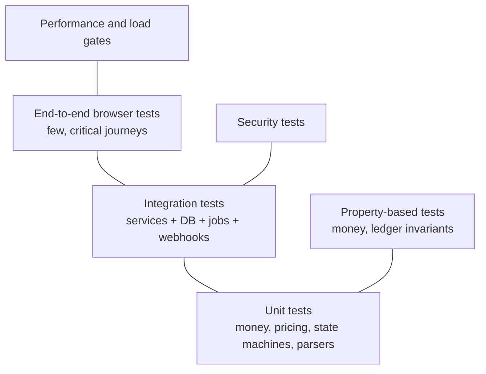

# 015 — Testing and Benchmark Gates

## 1. Test pyramid

| Layer | Tools (suggested) | Scope |
|---|---|---|
| Unit | `pytest`, `pytest-django` | Money, pricing, tax, landed cost, importers, normalisers, permission checks |
| Property-based | `hypothesis` | Ledger sums, money arithmetic, reservation logic, idempotency |
| Integration | `pytest-django` with real PostgreSQL (via containers) | Services, transitions, jobs, webhooks, adapters with fixtures |
| End-to-end | Playwright | Shopper journeys, dashboard core flows, RTL screenshots |
| Contract | Recorded fixtures | Payment and courier adapters, replayable |
| Performance | Lighthouse CI, `k6` or Locust | Budgets from phase 001, load tests |
| Security | `bandit`, `pip-audit`, custom permission matrix tests, ZAP baseline scan | Phase 014 |

Use real PostgreSQL in tests, not SQLite, because locking, constraints and full-text search behave differently.

## 2. Critical journeys (E2E must always pass)

1. Shopper: browse → filter → product → add to cart → checkout with COD → confirmation → track order.
2. Shopper in Arabic/RTL: same journey, screenshot-compared.
3. Staff: create product with variants → receive stock via PO → see it on the storefront.
4. Staff: pack and ship an order with the manual courier → mark delivered → COD expected appears.
5. Staff: import courier settlement → matches and review queue.
6. Owner: apply preset → complete wizard → publish.
7. Operator: upgrade with migration and rollback on a staging install.

## 3. Invariants that must hold (run as tests and nightly checks)

| ID | Invariant |
|---|---|
| INV-1 | For every variant/location, `stock_level.on_hand` equals the sum of ledger deltas |
| INV-2 | `reserved` equals the sum of active reservations |
| INV-3 | `available` never goes negative unless negative stock is explicitly allowed |
| INV-4 | An order total equals the sum of its line totals plus shipping minus discounts (to the minor unit) |
| INV-5 | Each paid order has payments summing to its total (or a COD expectation equal to it) |
| INV-6 | A serial number is in exactly one state and one location at any time |
| INV-7 | Ledger and audit tables reject UPDATE and DELETE from the app role |
| INV-8 | Replaying any webhook any number of times leaves state unchanged after the first |

## 4. Concurrency tests

- 50 simultaneous checkouts for 10 units: exactly 10 succeed, no oversell, ledger consistent.
- Simultaneous receipt and shipment on the same variant/location: no deadlock beyond a timeout; consistent result.
- Double-submit of checkout and of payment webhooks.
- Reservation expiry job running while a payment webhook arrives: order ends in one consistent state.

## 5. Performance gates (from phase 001 budgets)

| Gate | Tool | Fails the build when |
|---|---|---|
| Lighthouse mobile on home, collection, product | Lighthouse CI | LCP, CLS, TBT or size budgets exceeded |
| Bundle size | Script | JS over 40 KB gzip or CSS over 25 KB gzip |
| Query counts | `assertNumQueries` | Any page exceeds its budget |
| Load: storefront | k6 | p95 latency above target at the stated request rate on the reference VPS |
| Load: checkout | k6 | Error rate above 0.5% or p95 above target |
| Report speed | Test | Any report above 2 s on the large data set |
| Memory | Container stats | Web container above the sizing guide limit under load |

**Reference environment:** define it explicitly (for example a 2 vCPU / 4 GB VPS) and run gates against it, not against a developer laptop. Record the exact spec in `docs/benchmarks/README.md`.

### Test data sets

- `small`: 500 products, 1,000 orders (CI default).
- `large`: 5,000 products (50,000 variants for search tests), 200,000 orders, 500,000 ledger rows. Generated by a seeded, deterministic script in `samples/` tooling.

## 6. Competitor comparison harness

A reproducible script (phase 001) runs the same Lighthouse and WebPageTest-style checks against DJET demo pages and any URL list. Rules:

- Publish the methodology next to any numbers: device profile, throttling, location, dates, tool versions, number of runs, median and spread.
- Re-run before using numbers in any sales material; stale numbers are not used.
- Comparisons are limited to what was measured. No claims about causes unless verified.

## 7. Quality gates in CI

1. Lint and format (`ruff`), type checks on core modules.
2. Import-linter contracts.
3. Unit, property and integration tests with coverage thresholds on core apps (suggested 90% on `core`, `inventory`, `orders`, `payments`).
4. Migration checks: no missing migrations, no unsafe operations on large tables without an expand/contract note.
5. Security jobs (phase 014).
6. Build image, run smoke test (`/healthz`, one storefront request).
7. Nightly: E2E, load tests, restore drill on the `large` data set.

## 8. Tasks in this phase

1. Test settings, factories, fixtures, containerised PostgreSQL for CI.
2. Invariant checks as reusable functions used by both tests and nightly jobs.
3. Concurrency test suite.
4. Playwright suite for the seven journeys, including RTL screenshots.
5. Lighthouse CI configuration with budgets and the bundle-size script.
6. k6 scripts for storefront and checkout, with documented request rates.
7. Seeded data generators for `small` and `large`.
8. CI pipeline with caching and nightly schedule.

## 9. Definition of done (phase 015)

- [ ] All invariants run in CI and nightly with alerting.
- [ ] Concurrency tests pass 100 consecutive runs.
- [ ] Performance gates block a deliberately regressing change in a demonstration PR.
- [ ] Reference environment spec and benchmark methodology documented.
- [ ] `PHASE-015-REPORT.md` includes measured numbers on the reference VPS.
