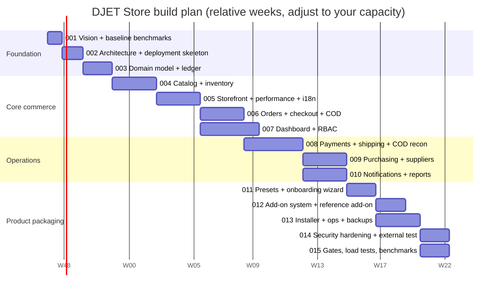

# 016 — Roadmap, Milestones and Packaging

## 1. Build order and checkpoints

The dates are placeholders to show relative sizing and parallelism. A solo developer should expect the total to be several months; with a coding agent doing implementation and the founder reviewing, compress cautiously and protect phases 003, 013 and 014 from compression because mistakes there are expensive.

## 2. Minimum sellable product (MSP)

The first version a paying merchant can use. Everything below must be complete; everything not listed waits.

| Included | Phase |
|---|---|
| Catalogue with variants, condition, barcodes, import/export | 004 |
| Multi-location stock with ledger, adjustments, counts, transfers | 003, 004 |
| Fast bilingual storefront with COD checkout | 005, 006 |
| Dashboard with roles and 2FA | 007 |
| Manual courier, zones, COD reconciliation | 008 |
| One online payment method (or COD plus manual transfer only if no gateway ready) | 008 |
| Suppliers, POs, receiving | 009 |
| WhatsApp or SMS/email notifications for the core events | 010 |
| Core reports (sales, margin, valuation, COD outstanding) | 010 |
| One vertical preset matching the first merchant | 011 |
| Installer, backups, restore drill, data export | 013 |
| Security baseline and external review | 014 |

Add-ons beyond the reference add-on, more courier adapters, more gateways, POS and the mobile app are **post-MSP**.

## 3. First-customer strategy (to protect scope)

1. Choose **one vertical and one friendly first merchant** and build the preset for them first. Electronics is a natural start because the competitor study shows deep need (serials, used goods, branches).
2. Run the first install in parallel with the merchant's current store for a short period. Import their catalogue and compare operations side by side.
3. Treat the first three merchants as co-designers. Fix what breaks, resist custom features, and record each request as either a preset change, an add-on, or a "no".
4. Keep a public-facing demo store running the `candidate` release with the 5,000-product seed so prospects can try speed and the dashboard themselves.

## 4. Packaging and pricing (hypotheses to test, not decisions)

Merchants are price-sensitive, and DJET has no revenue yet. Hypotheses:

| Offer | Includes | Charging model |
|---|---|---|
| Setup | Provisioning, data import, preset configuration, training | One-time fee |
| Hosting + support | VPS (or merchant's own), backups, updates, monitoring, support hours | Monthly fee, tiered by size |
| Add-ons | Optional modules | One-time or small monthly each |
| Custom work | Special integrations | Time and materials |

Principles:

- No per-order commission. This is a clear contrast with percentage-fee platforms and with app-store stacking.
- Be transparent about hosting cost, because hosting is a real cost per install.
- Verify local pricing by interviewing at least 10 target merchants and checking current competitor plans directly on their sites. Do not rely on this document for market prices.
- Keep unit economics visible: support time per install is the main risk to margin.

## 5. Risks and mitigations

| Risk | Mitigation |
|---|---|
| Scope creep ("one more feature") | MSP list above; every request classified as preset, add-on or no |
| Support load per install | Standard install, runbooks, monitoring, restore drills, upgrade CLI |
| Payment/courier API changes | Adapter isolation, contract tests with fixtures, alerting on adapter errors |
| WhatsApp policy and cost surprises | Official provider only by default, confirm pricing before promising, SMS/email fallback |
| Data loss | Tested backups, restore drills, pre-upgrade backups |
| Security incident | Baseline in phase 014, independent test before scaling, incident runbook |
| Single-person bottleneck | Documentation as a deliverable, agent-readable blueprints, automation |
| Legal/compliance gaps | Lawyer review of privacy, merchant agreements and tax invoicing before launch |
| Tax invoicing requirements | Verify current Egyptian e-invoicing obligations for merchants with an accountant; plan an accounting/e-invoice add-on if required |

## 6. Success metrics for the first six months after launch

- Time from signed merchant to live store: under 7 days.
- Storefront Lighthouse mobile performance score and LCP meet phase 001 budgets on every install.
- Zero data-loss incidents; monthly restore drills pass.
- Support hours per install per month trending down.
- Merchant retention and referral rate (qualitative at first).
- COD outstanding days trending down for merchants using reconciliation.

## 7. After the MSP

Candidates in rough order, to be decided by merchant demand: promotions engine, POS, installments display, more couriers, accounting export, mobile app API and companion app, reviews, loyalty. Move performance-critical or operationally heavy pieces to Go only when measurements justify it.

## 8. Definition of done (phase 016)

- [ ] MSP checklist confirmed against the implemented phases.
- [ ] Pricing hypotheses validated or revised after merchant interviews.
- [ ] First-merchant pilot plan agreed, including success criteria.
- [ ] `PHASE-016-REPORT.md` written, with a decision log of what was learned.
