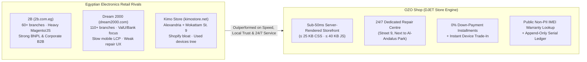
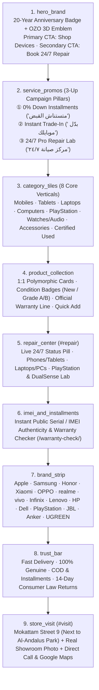

# OZO Shop — DJET Systems Initial Architecture & UI Design Schema

**Client:** OZO Shop (`أوزو شوب`) — Established 2006 (20 Years in Market)  
**Engineering & Design Partner:** [DJET Systems](https://djet.online)  
**Repository:** `https://github.com/DJET-Systems/ozo-store`  
**Base Engine:** DJET Store (Django 6.1 LTS · Python 3.14+ · PostgreSQL 18 · HTMX · Zero-Trust RBAC)  
**Active Vertical & Brand Overlay:** `PRESET=electronics` + `DJET_BRAND_PROFILE=ozo`

---

## 1. Merchant Identity & Operational Footprint

| Attribute | Verified Value | Source |
| :--- | :--- | :--- |
| **Brand Name (EN / AR)** | **OZO Shop** / **أوزو شوب** | Storefront & Social Creatives |
| **Heritage** | **20 Years** (`2006 – 2026`) — *"20 سنة من الثقة والنجاح.. والحكاية لسه مستمرة"* | 20th Anniversary Campaign Asset |
| **Physical Headquarters** | **Al-Moqattam, 9th Street, next to Al-Andalus Park, Cairo** (`المقطم، شارع ٩، بجوار حديقة الأندلس`) | Storefront & Campaign Footer |
| **Dedicated Repair Lab** | **OZO Mobile & Tech Service** — Located directly next to the main showroom, staffed **24/7** by professional technicians | Storefront Signage (`unnamed.webp`) & Client Brief |
| **Sales & WhatsApp Line** | `01026646657` (`+201026646657`) | Primary Campaign Line |
| **Orders & Inquiries Line** | `01026646658` (`+201026646658`) | Audio/Accessory Campaign Line |
| **Instagram** | [`https://www.instagram.com/ozo__shop/`](https://www.instagram.com/ozo__shop/) | Official Social |
| **Facebook** | [`https://www.facebook.com/OZOShopEgypt/`](https://www.facebook.com/OZOShopEgypt/) | Official Social |

### Core Product & Service Pillars
1. **Mobile Phones** — Flagship & mid-range smartphones (Apple iPhone, Samsung, HONOR, Xiaomi, OPPO, realme, vivo, Infinix) + Certified Pre-Owned (`Used Grade A/B`) + Trade-In (`بدّل موبايلك وادفع أقل فرق`).
2. **Tablets** — Apple iPad & Android tablets, styluses, folios, and screen/board repair.
3. **Laptops** — Gaming, business, and student laptops (Lenovo, HP, Dell, ASUS) + RAM/SSD upgrades and motherboard servicing.
4. **Desktop Computers & Peripherals** — Custom builds, monitors, storage, and networking accessories.
5. **PlayStation & Gaming** — PS5 Slim / Pro consoles, DualSense controllers, headsets, and dedicated HDMI/cooling/analog-drift repair.
6. **Smartwatches, Audio & Accessories** — Apple Watch, AirPods, JBL portable speakers (`Xtreme 4`, `Flip 6`), UGREEN GaN chargers (`X512 20W`), LENYES waterproof pouches, and classic retro Bluetooth/MP3 radios.
7. **24/7 Pro Repair Centre** — Round-the-clock diagnostics, micro-soldering, screen/battery replacements, and console maintenance next door to the main Street 9 showroom.

---

## 2. Competitive Benchmark: 2B vs. Dream 2000 vs. Kimo Store vs. OZO Shop

| Dimension | **2B** (`2b.com.eg`) | **Dream 2000** (`dream2000.com`) | **Kimo Store** (`kimostore.net`) | **OZO Shop** (`DJET Store`) |
| :--- | :--- | :--- | :--- | :--- |
| **Mokattam Street 9 Presence** | Mall/chain presence | General chain branch | Direct local rival on Street 9 | **20-year anchor next to Al-Andalus Park + adjacent 24/7 repair center** |
| **Storefront Architecture** | Heavy enterprise e-commerce stack | Heavy JS bundle, slow mobile TTI | Bloated third-party Shopify theme | **DJET Server-Rendered HTML + HTMX (`< 5 KB` gzipped CSS)** |
| **Repair & Maintenance UX** | Back-office RMA (up to 60-day hold terms) | External authorized service centers | Limited branch-level warranty | **First-class 24/7 Repair Centre hero + instant WhatsApp booking** |
| **Trade-In (`استبدال`)** | Separate evaluation form | In-branch only | Ad-hoc used catalog | **Dedicated homepage pillar + pre-filled WhatsApp valuation flow + Grade A/B badges** |
| **Installments (`تقسيط`)** | Bank + ValU / Forsa / Aman | Heavy ValU / Contact / Souhoola banners | Static info page | **12-month auto-calculated installment hint on every product + 0% down campaign pillar** |
| **Warranty Verification** | Requires customer login / call center `16420` | Requires invoice / hotline `16942` | Manual inquiry | **Self-service `/warranty-check/` by IMEI/Serial (Zero-PII leak invariant)** |

---

## 3. Visual Design System & Color Tokens (`apps/presets/brands/ozo.json`)

Extracted directly from OZO Shop's physical storefront signage, 3D emblem, and 20th-anniversary campaign creatives (now archived in `docs/clients/ozo/brand-reference/*.webp`):

| CSS Custom Property | Hex Value | Visual Role & Provenance |
| :--- | :---: | :--- |
| `--accent` | `#005CA9` | **OZO Cobalt Blue** — Sampled from primary 3D logo badge (`#015BA7` / `#005CA9`). Used for primary buttons, active borders, and price highlights. |
| `--accent-hover` | `#004A8A` | Deepened cobalt state for interactive hover/focus transitions. |
| `--accent-light` | `#E3EEF9` | Soft ice-blue tint for badges, phone chips, and cart pills. |
| `--brand-navy` | `#0A1F5C` | **Campaign Royal Navy** — Sampled from "متستناش القبض" and "بدّل موبايلك" campaign backdrops. |
| `--brand-navy-deep` | `#061440` | **Midnight Stage Navy** — Sampled from the 20-Years Anniversary stage gradient (`#001B76` → `#061440`). |
| `--brand-indigo` | `#353383` | **Signage Indigo** — Sampled directly from physical exterior "OZO SHOP · Mobile Service" signage (`unnamed.webp`). |
| `--brand-gold` | `#F5B82E` | **20th Anniversary Ribbon Gold** — High-contrast warm gold for primary Hero CTAs and the 20-Year milestone badge. |
| `--brand-gold-ink` | `#3A2A00` | High-contrast dark ink on `--brand-gold` buttons (WCAG AAA contrast). |
| `--bg` | `#F4F7FB` | Cool studio off-white background that makes dark navy hero cards and white product tiles pop. |
| `--surface` | `#FFFFFF` | Pure white card surface with `#D9E2EE` borders and `16px` card radius. |
| `--text` | `#0B1B33` | Deep navy-charcoal body typography (`'IBM Plex Sans Arabic', system-ui, sans-serif`). |

---

## 4. Storefront Information Architecture & Section Schema

When `DJET_BRAND_PROFILE=ozo` is active, the `electronics` vertical preset composes a 9-section high-conversion homepage:

---

## 5. Dedicated Dashboard & Operational Schema for OZO Shop

Because OZO Shop operates a **hybrid retail + trade-in + 24/7 repair center**, the DJET Store back-office (`admin.djet.localhost` / `/staff/`) enforces strict operational and security boundaries:

1. **Multi-Location Stock Ledger (`apps/inventory`):**
   - **Location 1:** `Mokattam Main Showroom (Street 9)` — Public retail branch (`is_public_branch=True`) for new devices, PlayStation consoles, and accessories.
   - **Location 2:** `OZO 24/7 Repair Centre (Next Door)` — Dedicated service & spare-parts location (`screens`, `batteries`, `charging ICs`, `DualSense sticks`).
   - **Location 3:** `Trade-In Quarantine & Inspection Bay` — Holds incoming customer trade-in devices until technicians grade them (`used_a`, `used_b`, `refurbished`) and serialize their IMEI into `SerialUnit`.
2. **Serial & IMEI Lifecycle (`SerialUnit` + `StockMovement`):**
   - Every phone, tablet, laptop, and PlayStation console is tracked with `tracking_mode="serial"`.
   - Selling a device records an immutable `StockMovement` row with `select_for_update()` locking and activates its warranty window for public `/warranty-check/` lookups without exposing customer PII or purchase cost (`cost_amount`).
3. **Zero-Trust Staff RBAC (`apps/core/rbac.py`):**
   - **Owner / Manager** (Mandatory TOTP 2FA): Full access to supplier costs (`cost_amount`), margin reports, and preset settings.
   - **Cashier** (Showroom POS): Order creation, COD collection, IMEI lookup; **zero access to supplier cost prices**.
   - **Warehouse / Repair Lead**: Stock receiving, serial intake, trade-in grading, spare-parts transfers.
   - **Accountant**: COD courier settlement reconciliation and financial exports.
   - **Support**: Order tracking and WhatsApp customer care (`01026646657` / `01026646658`).

---

## 6. Related Engineering Documents

- **[Production-Readiness Audit, Master Execution Roadmap & Decision Log (1,500+ Daily Users)](PRODUCTION-READINESS-ROADMAP.md)** — Full line-by-line codebase gap analysis, capacity engineering for 1,500+ DAU, 4-sprint implementation plan, and open questions for OZO Shop's production launch.

