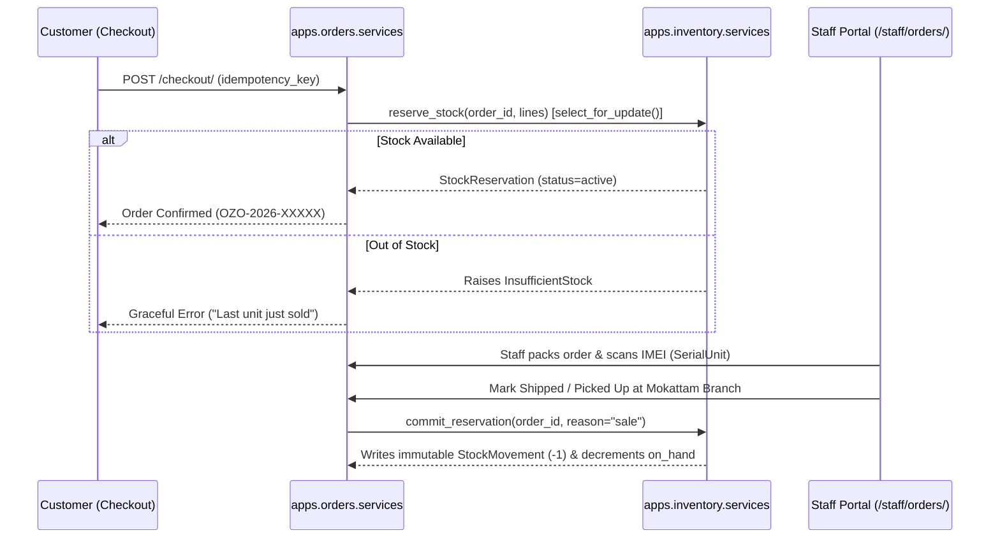
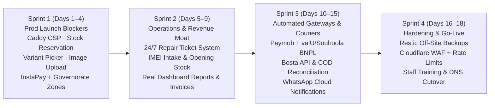

# OZO Shop (`ozo-store`) — Production-Readiness Audit, Master Execution Roadmap & Decision Log (1,500+ Daily Users)

**Client:** OZO Shop (`أوزو شوب`) — Al-Moqattam, 9th Street, next to Al-Andalus Park, Cairo  
**Engineering & Design Partner:** [DJET Systems](https://djet.online)  
**Target Scale:** 1,500–5,000+ Daily Active Users (DAU) in Egypt  
**Document Date:** 19 November 2026  

---

> **Executive Verdict:** The repository has an institutional-grade **core engine** (`apps/core`, `apps/inventory`, `apps/catalog`, `apps/presets`) featuring an append-only stock ledger, integer-piastre money math, Argon2id + RFC 6238 TOTP 2FA, and surface-isolated cookies. **However, 7 of the 13 domain apps are still 1-line placeholder stubs** (`payments`, `shipping`, `purchasing`, `notifications`, `reports`, `customers`, `addons`), and several critical production blockers in `deploy/Caddyfile`, `deploy/backup/entrypoint.sh`, and `apps/orders` must be resolved before hosting live public traffic.

---

## 1. Ground-Truth Codebase Audit (What Exists vs. What Is Missing Today)

| Module / Layer | Current Codebase State | Production Readiness | Critical Debt Found in Code |
| :--- | :--- | :---: | :--- |
| **`apps/core`** (`models.py`, `rbac.py`, `totp.py`, `money.py`) | **1,066 LOC.** `StaffUser`, `Role`, 22 RBAC permissions, immutable `AuditLog` trigger, `Money` value object, `EncryptedTextField` (Fernet), RFC 6238 TOTP. | **90%** | No rate-limiting on public endpoints (`/track/`, `/warranty-check/`, `/checkout/`); `CONN_MAX_AGE` not configured in `config/settings/base.py`. |
| **`apps/inventory`** (`models.py`, `services.py`) | **776 LOC.** `Location`, `StockLevel`, append-only `StockMovement`, `StockReservation`, `SerialUnit`, `Batch`. Row-locked `select_for_update()` in deterministic `(variant_id, location_id)` order. | **85%** | **Not wired to `apps/orders` yet!** Placing an order in `apps/orders/services.py` does not yet call `inventory.services.reserve_stock()`, meaning two concurrent buyers can buy the last iPhone. Also needs Staff UI for receiving stock & scanning IMEIs. |
| **`apps/catalog`** (`models.py`, `services.py`) | **902 LOC.** `Category`, `Product`, `Variant`, CSV importer (`import_products`), barcode lookup (`lookup_barcode`). | **75%** | Uses `image_url` string paths instead of multipart image upload + automatic WebP resizing pipeline into `MEDIA_ROOT`. No PostgreSQL Full-Text / Trigram search (`pg_trgm`) for Arabic/English product search. |
| **`apps/storefront`** (`views.py`) & **`apps/presets`** (`brands/ozo.json`) | **628 LOC.** OZO Shop brand profile, 9 homepage sections, SVG icon system, cart, COD & Branch Pickup checkout, warranty check, order tracking. | **70%** | Variant selector on `product_detail.html` renders static chips instead of switching the hidden `sku` input; no `/i18n/setlang/` language toggle button in header; no search/filter bar on category pages; no SEO (`sitemap.xml`, `robots.txt`, JSON-LD `Product` schema). |
| **`apps/orders`** (`models.py`, `services.py`) | **326 LOC.** `Order` & `OrderItem` with COD and Branch Pickup, status transitions, and audit logs. | **45%** | Missing `idempotency_key` (double-click protection), stock reservation hook (`reserve_stock` / `commit_reservation` / `release_reservation`), IMEI serial assignment at packing, coupon/discount codes, and return/refund workflow (`OrderReturn`). |
| **`apps/dashboard`** (`views.py`, `auth_views.py`) | **897 LOC.** Login, 2FA, Staff Invites, Today KPIs, Add/Archive Product, Order status update, CSV export. | **50%** | Missing full product/variant edit screen, stock adjustment/receiving UI, serial/IMEI intake scanner UI, printable thermal receipt / A4 tax-invoice view, and **24/7 Repair Ticket Management** screen. |
| **`apps/payments`** (`models.py`, `services.py`) | **1-line stub.** | **0%** | No `Payment` model, no webhook signature verifier, no Paymob / Kashier / Fawry / InstaPay manual-proof or BNPL (**valU**, **Souhoola**, **Sympl**, **Contact**, **Forsa**) integration. |
| **`apps/shipping`** (`models.py`, `services.py`) | **1-line stub.** | **0%** | Hardcoded 75 EGP shipping fee instead of `ShippingZone` rate table by Egyptian Governorate; no `Shipment` model; no **Bosta** or **Mylerz** AWB generation/webhook; no `CourierSettlement` COD cash reconciliation engine. |
| **`apps/notifications`** (`models.py`, `services.py`) | **1-line stub.** | **0%** | No async **Procrastinate** tasks sending WhatsApp Cloud API / SMS Misr messages when an order is placed, ready for Mokattam branch pickup, or out for delivery. |
| **`apps/purchasing`** (`models.py`, `services.py`) | **1-line stub.** | **0%** | `purchasing_list.html` is a static shell. Needs `Supplier`, `PurchaseOrder`, and goods receipt into `inventory.services.record_movement(reason="purchase_receipt")`. |
| **`apps/reports`** (`models.py`, `services.py`) | **1-line stub.** | **0%** | `reports.html` shows hardcoded `0.00 EGP` numbers instead of real SQL aggregations over `Order`, `OrderItem`, and `StockLevel`. |
| **`deploy/`** (`compose.yml`, `Caddyfile`, `backup/entrypoint.sh`) | **Production Docker Compose + Caddy + Postgres roles.** | **65%** | **3 Critical Prod Bugs:** ① `Caddyfile` sets `style-src 'self'`, which blocks `` token injection and inline styles in production! ② `deploy/backup/entrypoint.sh` is a `sleep 300` stub (zero actual `pg_dump` or `restic` backups!). ③ `apply_db_grants.py` revokes `UPDATE/DELETE` on `core_audit_log`, which can block `StaffUser` deletion unless `ON DELETE SET NULL` executes under table owner privileges. |

---

## 2. Capacity & Traffic Engineering for 1,500+ Daily Users in Egypt

Sizing for **1,500–5,000 Unique Daily Visitors (DAU)** with typical Egyptian mobile retail traffic patterns (evening spikes between **8:00 PM and 1:00 AM Cairo Time** after Facebook/Instagram/TikTok ad drops):

*   **Daily Pageviews & Requests:** $1,500 \text{ users/day} \times 12 \text{ pages/session} = \mathbf{18,000\text{ HTML requests/day}}$ ($\approx 120,000$ total HTTP requests/day including static/media).
*   **Peak Traffic (Flash Sale / TikTok Reel Spike):** $40\%$ of daily traffic in a 2-hour window $\rightarrow \mathbf{2\text{ to }15\text{ requests/sec}}$ sustained, with burst peaks of **$40\text{ req/s}$**.
*   **Database Session Bloating Risk:** Every anonymous shopper adding to cart creates a row in `django_session`. At 1,500 users/day + crawlers, `django_session` grows by **50,000+ rows/month**. Without a daily `clearsessions` job and connection pooling, PostgreSQL latency degrades.

### Mandatory Infrastructure & Performance Upgrades for 1,500+ DAU

1.  **Fix the Production `Content-Security-Policy` in `deploy/Caddyfile` (P0 Blocker):**
    *   *The Bug:* `Caddyfile` currently sends `Content-Security-Policy "... style-src 'self'; script-src 'self' ..."`. In production behind Caddy, the browser will **block** the `` block in `base.html`, every `style="..."` attribute in the templates, and the `onchange` handler on the checkout radio buttons.
    *   *The Fix:* Move dynamic `:root` tokens to a dedicated `/theme.css` endpoint (or CSP nonce) and update `Caddyfile` `style-src 'self' 'unsafe-inline'`.
2.  **Persistent Database Connections (`CONN_MAX_AGE`) & Health Checks:**
    *   *The Bug:* `config/settings/base.py` uses default `CONN_MAX_AGE = 0`, opening and closing a brand-new TCP + PostgreSQL backend process on every single HTTP request.
    *   *The Fix:* Set `CONN_MAX_AGE = 60` and `CONN_HEALTH_CHECKS = True` in `DATABASES["default"]`, and scale `web-store` Gunicorn in `deploy/compose.yml` to `--workers 4 --threads 4` ($16$ concurrent request threads) with `memory: 1024M` and `db` `memory: 1536M`.
3.  **Cloudflare CDN + Edge Caching in Front of Caddy:**
    *   Put the domain (`ozoshop.eg` / `ozoshop.com`) behind **Cloudflare (Cairo / Marseilles Edge PoP)** for DDoS protection, WAF rate-limiting, and zero-origin-hit caching of `/static/*` and `/media/*`.
    *   Add a scheduled Procrastinate periodic task running `django.core.management.call_command("clearsessions")` every night at 04:00 AM Cairo time.

---

## 3. Core Commerce & Inventory Ledger Debt (Preventing Overselling & Race Conditions)

Right now, `apps/orders` and `apps/inventory` are disconnected. For a real electronics shop selling high-value serialized items (an iPhone 18 Pro Max at `78,999 EGP` or a Certified Used Grade A iPhone 15 Pro where quantity $= 1$), this is the #1 financial invariant to close:

### Concrete Engineering Steps:
1.  **Wire `create_order_from_cart()` to `inventory.services`:**
    *   On order placement: call `inventory.services.reserve_stock()` inside the same `@transaction.atomic` block. If `InsufficientStock` is raised, abort checkout cleanly and show which item ran out.
    *   On transition to `shipped` or `delivered` (for branch pickup): call `inventory.services.commit_reservation()` to write the append-only `StockMovement(reason="sale")` entry and mark the assigned `SerialUnit.status = "sold"`.
    *   On transition to `cancelled`: call `inventory.services.release_reservation()` so the reserved unit immediately returns to available stock.
2.  **Checkout Idempotency & Variant Switching:**
    *   Add `idempotency_key = models.UUIDField(unique=True)` to `Order` (injected as a hidden input in `checkout.html`) so double-tapping "Confirm & Place Order" on a slow 4G connection never creates duplicate COD orders (`UC-601`).
    *   Make the variant chips on `product_detail.html` interactive (`?sku=...` or radio buttons updating the `sku` input, price, and condition badge) so customers can select `256GB Space Black` vs. `512GB Deep Burgundy`.
3.  **Staff Portal Media Upload & Stock/IMEI Intake:**
    *   Upgrade `Product.image_url` to support direct file upload (`<input type="file" accept="image/*">`) in `/staff/products/`, automatically stripping EXIF metadata and converting to `800x800` WebP in `/app/media/products/`.
    *   Add a **"Receive Stock & Scan IMEIs"** action in `/staff/inventory/` calling `inventory.services.record_movement(reason="purchase_receipt")` and registering `SerialUnit` IMEIs so `/warranty-check/` works automatically for every phone sold.

---

## 4. Payments, BNPL Installments & Courier / COD Reconciliation (The Egyptian Market Stack)

OZO Shop's social campaigns heavily promote **"متستناش القبض — قسّط بدون مقدم وبدون فوائد"** (0% down-payment installments) and **"بدّل موبايلك"** (Trade-In). While **COD** and **Pay at Mokattam Branch** are live today, scaling online profit requires integrating Egypt's real payment and courier rails into `apps/payments` and `apps/shipping`:

### A. Egyptian Payment & BNPL Gateway Roadmap (`apps/payments`)
1.  **Tier 1 — Instant Manual Digital Transfer (`InstaPay` & `Vodafone Cash`):**
    *   Add `payment_method="instapay"` to checkout: displays OZO Shop's official **InstaPay IPA / bank QR** and **Vodafone Cash wallet number**, and lets the customer enter the 12-digit reference number or upload a transfer screenshot (`PaymentProof`). Order stays `pending` until staff clicks **"Verify Transfer"** in `/staff/orders/`. Zero gateway commission!
2.  **Tier 2 — Hosted Payment Aggregator (`Paymob` or `Kashier`):**
    *   Implement `apps/payments/providers/paymob.py` behind a single aggregator account (`Paymob Accept` or `Kashier`) which unlocks all Egyptian payment methods in one integration:
        *   **Credit / Debit Cards & Meeza** (`Visa`, `Mastercard`, `Meeza`).
        *   **Consumer Finance / BNPL (Crucial for 15,000–90,000 EGP Phones & PS5s):** **valU**, **Souhoola**, **Sympl**, **Forsa**, **Aman**, and **Contact**, plus **Bank Installments** (`CIB`, `NBE`, `Banque Misr`, `QNB`).
    *   Enforce HMAC-SHA512 webhook signature verification, idempotent event deduplication (`provider_event_id`), and strict amount matching (`webhook.amount_cents == order.total_amount`) before marking an order paid.

### B. Egyptian Shipping Zones, Couriers & COD Cash Reconciliation (`apps/shipping`)
1.  **Governorate Shipping Zone Engine:**
    *   Replace the flat `75.00 EGP` fee with `ShippingZone` seeded from `samples/shipping_zones.csv`:
        *   *Zone 1 — Al-Moqattam / New Cairo / Maadi / Nasr City:* `50 EGP` (Same-Day / Next-Day local OZO runner or courier).
        *   *Zone 2 — Greater Cairo & Giza:* `75 EGP` (24–48h).
        *   *Zone 3 — Alexandria & Delta:* `95 EGP` (48–72h).
        *   *Zone 4 — Upper Egypt, Canal & Red Sea:* `125 EGP` (3–5 days).
2.  **Courier Adapter (`Bosta` / `Mylerz` + Manual AWB):**
    *   Build the Manual Courier adapter first (staff enters the AWB tracking number and courier name in `/staff/orders/`) + one automated API adapter (**Bosta** is the market standard for electronics in Cairo), auto-generating the PDF shipping label and receiving delivery status webhooks.
3.  **COD Cash Reconciliation Ledger (`CourierSettlement`):**
    *   When a COD order is delivered, record a `CodExpected` entry. Let OZO's accountant upload Bosta's weekly payout CSV (`samples/courier_settlement.csv`) to auto-match collected cash against expected amounts and flag any missing or underpaid COD shipments.

---

## 5. Dedicated OZO Shop Revenue Differentiators (24/7 Repair Ticketing & Trade-In Intake)

To convert OZO Shop's physical moat on Mokattam Street 9 into direct online revenue:
1.  **24/7 Repair Booking & Live Repair Tracker (`/repair-book/` & `/staff/repairs/`):**
    *   Add a `RepairTicket` model (`ticket_ref="REP-2026-XXXX"`, `customer_name`, `customer_phone`, `device_category`, `device_model`, `serial_or_imei`, `issue_description`, `estimated_cost_amount`, `status`: `received` ➔ `diagnosing` ➔ `awaiting_parts` ➔ `in_repair` ➔ `ready_for_pickup` ➔ `completed`).
    *   Customers can book a repair online or check if their device is ready for pickup at the 24/7 lab, and technicians update the status from the Staff Portal.
2.  **Structured Trade-In Valuation Form (`/trade-in/`):**
    *   Captures customer's current device model, storage, battery health %, screen/body condition, and target upgrade device, creating a `TradeInLead` in the Staff Portal and opening a pre-formatted WhatsApp chat with OZO's trade-in specialist.
3.  **Automated WhatsApp / SMS Order Notifications (`apps/notifications`):**
    *   Wire **Procrastinate** background worker jobs to send automated Arabic WhatsApp / SMS Misr notifications on 4 key events:
        1. *Order Received (`OZO-2026-XXXXX`)*
        2. *Ready for Pickup at Mokattam Street 9 Branch*
        3. *Shipped with Courier + Tracking Link*
        4. *24/7 Repair Ticket Ready for Collection*

---

## 6. Non-Technical, Legal, Financial & Operational Requirements (Real Business Launch Checklist)

Before taking live public traffic, OZO Shop and DJET Systems must complete these 7 operational steps:

1.  **Domain, DNS & Business Email Provisioning:**
    *   Register `ozoshop.eg` (via `.eg` registry / Egyptian Commercial Register) or `ozoshop.com`.
    *   Configure Cloudflare DNS records: `ozoshop.com` / `shop.ozoshop.com` (Storefront) and `admin.ozoshop.com` (Staff Portal — isolated hostname required by `ADR-0002` for `__Host-djet_admin_sid` cookies!).
    *   Configure transactional email (`SPF`, `DKIM`, `DMARC`) for staff invites and order receipts.
2.  **Merchant Onboarding with Paymob / Kashier & BNPL Partners (`valU` / `Souhoola`):**
    *   Requires OZO Shop's **Commercial Register (`السجل التجاري`)**, **Tax Card (`البطاقة الضريبية`)**, **National ID of Company Owner**, and a **Corporate Bank Account IBAN**.
    *   *Lead time:* 5–10 business days for KYC approval. (This is why launching Phase 1 with **COD + Branch Pickup + InstaPay** is the right business move while KYC runs in parallel).
3.  **Courier Corporate Account (`Bosta` / `Mylerz`):**
    *   Sign corporate COD agreement with **High-Value Electronics Insurance** (mandatory when shipping laptops, PS5s, and iPhones worth `15,000–90,000 EGP`) and "Open Package Inspection in Presence of Courier" terms.
4.  **Egyptian Tax Authority (`مصلحة الضرائب المصرية`) & Consumer Protection Compliance:**
    *   Publish mandatory legal pages in the storefront footer:
        *   **14-Day Return & Exchange Policy** (compliant with Egyptian Consumer Protection Law No. 181 of 2018, explicitly distinguishing sealed new devices vs. inspected `Used Grade A/B` devices).
        *   **Warranty Terms & Conditions** (distinguishing local distributor warranty e.g. Raya/ABM/KMG vs. OZO Shop 3-month pre-owned warranty).
        *   **Privacy Policy & Terms of Service.**
    *   Ensure order receipts include OZO Shop's Tax Registration Number (`رقم التسجيل الضريبي`) and prepare for **ETA E-Receipt (`الإيصال الإلكتروني`)** integration if mandated for OZO's tax bracket.
5.  **Production VPS & Off-Site Encrypted Backups:**
    *   Provision a dedicated Linux VPS (e.g. Hetzner / DigitalOcean / AWS Frankfurt or Bahrain — minimum **4 vCPU, 8 GB RAM, 160 GB NVMe SSD** for <$25/mo, which comfortably handles 5,000+ DAU on this stack).
    *   Replace the `sleep 300` stub in `deploy/backup/entrypoint.sh` with an automated daily `pg_dump -Fc` + `/media` backup encrypted with **Restic** and pushed to off-site object storage (Backblaze B2 / Cloudflare R2 / AWS S3), and run a monthly restore drill.
6.  **Showroom Staff Training & Physical Barcode / IMEI SOP (Street 9, Al-Moqattam):**
    *   Create individual `StaffUser` accounts with strict RBAC roles:
        *   **Owner** (`Owner` role + mandatory TOTP 2FA on phone).
        *   **Showroom Manager** (`Manager` role + mandatory TOTP 2FA).
        *   **Front-Desk Cashiers** (`Cashier` role — can process orders and branch pickups, cannot see supplier costs or edit prices).
        *   **24/7 Repair Lab & Stock Lead** (`Warehouse` role — receives stock, scans IMEIs, updates repair tickets).
    *   Connect a USB HID Barcode/QR scanner at the Mokattam cashier desk to `/staff/barcode-scan/` for 1-second IMEI intake and warranty registration.
7.  **Opening Balance Physical Stock Count (`Day-0 Go-Live`):**
    *   Before flipping the DNS live, export OZO Shop's real current shelf stock into `samples/stock_opening_balance.csv`, run the opening-balance ledger import into `MAIN` (Mokattam Showroom) and `REPAIR24` (24/7 Repair Centre), and register all in-stock serialized phone IMEIs.

---

## 7. Prioritized 4-Sprint Execution Roadmap to Live Profit

| Sprint | Goal | Deliverables | Business Impact |
| :--- | :--- | :--- | :--- |
| **Sprint 1** *(Next Up)* | **Safe COD + Branch Pickup + InstaPay Go-Live** | 1. Fix `Caddyfile` CSP & `CONN_MAX_AGE=60` 2. Wire `Order` creation/cancellation to `inventory.services.reserve_stock()` + `idempotency_key` 3. Interactive variant selector on product page + Arabic/English language toggle + search bar 4. Staff Portal full product edit + image file upload (`.webp` converter) + Governorate shipping fees + **InstaPay / Vodafone Cash** checkout option | **Can host online immediately and take real money via COD, Branch Pickup & InstaPay with zero overselling.** |
| **Sprint 2** | **In-Store Operations, IMEI Ledger & 24/7 Repair Lab** | 1. Staff Portal Stock Receiving & IMEI Serial Scanner UI 2. **24/7 Repair Centre Booking & Ticket Tracker** (`/repair-book/` + `/staff/repairs/`) 3. Structured **Trade-In Lead Form** (`/trade-in/`) 4. Printable Customer Invoice / Thermal Receipt + Real SQL `apps/reports` dashboard (Sales, COGS, Gross Margin) | **Digitizes the 24/7 repair center, activates `/warranty-check/` for every sold device, and gives the owner real daily profit/margin visibility.** |
| **Sprint 3** | **BNPL Installments, Courier Automation & WhatsApp** | 1. `apps/payments`: **Paymob / Kashier** hosted checkout (Cards + **valU / Souhoola / Sympl / Forsa** installments) 2. `apps/shipping`: **Bosta** courier adapter + `CourierSettlement` COD payout CSV reconciliation 3. `apps/notifications`: Procrastinate async WhatsApp / SMS Misr alerts 4. `apps/purchasing`: Supplier & Purchase Order receiving | **Unlocks high-ticket online installment sales (iPhones, Laptops, PS5s) and eliminates lost courier COD cash.** |
| **Sprint 4** | **Scale, Backups, SEO & Production Cutover (1,500+ DAU)** | 1. Real **Restic + `pg_dump`** encrypted off-site backups in `deploy/backup/entrypoint.sh` + restore test 2. Endpoint rate-limiting on `/checkout/`, `/track/`, `/warranty-check/` + Cloudflare CDN/WAF 3. SEO (`sitemap.xml`, `robots.txt`, JSON-LD `Product` rich snippets, OpenGraph tags) + Legal pages | **Hardened for 1,500–5,000+ daily users, resilient against data loss and bot abuse, and indexed on Google Egypt.** |

---

## 8. Key Open Questions & Decisions for Tomorrow's Session (OZO Shop & DJET Engineering)

Before or during **Sprint 1**, we need to align on the following business and technical decisions with OZO Shop's owner:

1.  **Production Domain Name:**
    *   What exact domain will OZO Shop use in production (e.g., `ozoshop.eg`, `ozoshop.com`, or `ozoshop.net`) so we can pre-configure `STORE_DOMAIN` (`ozoshop.com`) and `ADMIN_DOMAIN` (`admin.ozoshop.com`) in `deploy/Caddyfile` and `.env.example`?
2.  **InstaPay & Vodafone Cash Receiver Details (For Immediate Sprint 1 Zero-Fee Digital Payments):**
    *   What is OZO Shop's official **InstaPay IPA address** (e.g. `ozoshop@instapay`) and **Vodafone Cash wallet number** (is it `01026646657`, `01026646658`, or a dedicated corporate wallet)?
    *   Should we require a 12-digit transaction reference number, an uploaded screenshot of the transfer receipt, or both at checkout?
3.  **COD High-Ticket Threshold Policy:**
    *   For high-value orders (e.g. an iPhone 18 Pro Max at `78,999 EGP` or a PS5 Slim at `29,999 EGP`), what is the maximum order total allowed for pure **Cash on Delivery** without a small down-payment deposit (via InstaPay) or mandatory phone verification?
4.  **Governorate Delivery Zones & Mokattam Local Runner:**
    *   Does OZO Shop have its own local delivery runner for **Al-Moqattam / Maadi / Nasr City / New Cairo** (e.g. 60-minute or same-day delivery), and what exact EGP shipping fees should we set for **Mokattam**, **Greater Cairo & Giza**, **Alexandria/Delta**, and **Upper Egypt**?
5.  **Primary Payment & BNPL Aggregator Choice (Sprint 3):**
    *   Does OZO Shop already have in-store POS / merchant contracts with **Paymob**, **Kashier**, **Fawry**, **valU**, **Souhoola**, **Contact**, or **Forsa**? Knowing which contracts they already signed for the physical Mokattam shop lets us prioritize that exact online gateway adapter first.
6.  **Primary Courier Partner (Sprint 3):**
    *   Which courier company does OZO Shop prefer for nationwide electronics shipping (**Bosta**, **Mylerz**, or **Aramex**)?
7.  **24/7 Repair Centre Online Workflow (Sprint 2):**
    *   When a customer books a repair online (`#repair`), should the website display fixed starting prices for common repairs (e.g., *"PS5 DualSense Hall-Effect Drift Fix — 650 EGP"*, *"Laptop Thermal Paste & Cleaning — 450 EGP"*) or generate a diagnostic ticket (`REP-2026-XXXX`) where the technician quotes the price after inspection?
8.  **Showroom Opening Hours vs. 24/7 Repair Centre Hours:**
    *   The repair center next door is confirmed **24/7**. What are the exact daily opening hours of the main retail showroom on Street 9 (currently set to `10:00 AM – 12:00 AM Daily`)?
